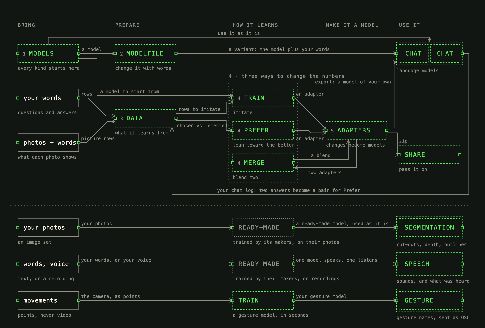

# Variable Machine

A localhost instrument for changing small language models on an Apple Silicon Mac: try models, change them with words, collect examples, train, blend, compare and share. Every click shows the real command it runs in a terminal at the bottom of the page.

**[variablemachine.orpiment.studio](https://variablemachine.orpiment.studio)** · download, and how to start.



## Start here

**You need:** a Mac with Apple Silicon (M1 or later) and 16GB of memory or more, macOS 14 or later, and about 10GB of free disk.

**1. Install two things** (once):

- **Ollama**, which runs the models: download it from [ollama.com](https://ollama.com/download) and install it. You don't need to open it.
- **Node 22 or newer**, which runs the app: download the LTS installer from [nodejs.org](https://nodejs.org) and open it.

**2. Paste one line into Terminal:** open **Terminal** (cmd-space, type *Terminal*, Return), paste this, and press Return:

```bash
curl -fsSL https://variablemachine.orpiment.studio/install.sh | bash
```

It downloads the newest release into `~/variable-machine`, makes a **Variable Machine** app in the Applications folder in your home folder, and opens it ([the script](site/install.sh)). The app opens a Terminal window, checks your Mac, and tells you plainly if Ollama or Node is missing. The first time it also installs uv (which runs training) and what the app uses, which takes a few minutes. Then it starts Ollama and the app and opens http://localhost:4817 in your browser. Every command it runs is shown with ▸ in front.

**Why not the zip?** macOS won't open a script downloaded in a browser unless Apple has signed it ("Apple could not verify …"; on macOS 26 there is no way past it). curl downloads aren't marked as downloaded, and the app is made on your own Mac, so macOS opens both.

**Next time,** open **Variable Machine** like any other app (cmd-space, type *Variable Machine*); you can drag it to the Dock. **To stop it,** close its Terminal window (or press ctrl-C in it). Variants you made on the Modelfile tab and didn't keep are cleared away when it stops. **To update it,** paste the same line again: your workspace (datasets, sets, adapters, models) stays as it is.

**Working on the code?** Clone the repository and use `npm run dev` instead: it rebuilds the page on every save and restarts the helper.

```bash
git clone https://github.com/studio0rpiment/variable-machine
cd variable-machine && npm install && uv sync --project python && npm run dev
```

**3. Your first ten minutes:**

1. **Start** shows a map of every tab and what flows between them, left to right: what you bring, preparing it, how a model learns, making it a model, using it. Click a box to open it; **about** has the same in words.
2. **Models:** press `ollama pull smollm2:360m` on its card (about 700MB). With no models yet, the four starters and a library to pull from are listed here.
3. **Modelfile:** choose a preset, press make variant, and ask both the original and your variant the same question.
4. **Data → Train:** choose a dataset, split it, open Train with it, and train. When it finishes, the next step exports your model and opens **Chat** with it.

**The class project:** [docs/exercise.md](docs/exercise.md): in groups of three, students choose one of the [four demos](docs/briefs/README.md) (public data, gallery, gesture, tangible), make it work, then retrain it on data of their own for a larger project. They hand in the model they made, as zips, with a [model card](docs/model-card-template.md) that says what they did, why, and what the larger project is, and show it in a three-minute demo.

**Four worked examples:** [docs/examples](docs/examples/README.md) has one model made each way (studio crit by words, colour → hex by examples, haiku that keep 5-7-5 by taste, and a blend of the last two), with the commands, manifests, loss numbers and before/after answers, including what went wrong first.

**If something isn't right:** `npm run doctor` checks Ollama, uv, Python and memory and says what to fix. Hover over any tab name or control for a flag that explains it.

**Disk:** smollm2:360m is 725MB and qwen3:4b 2.5GB in Ollama. The first training run downloads its base model into `workspace/hf` (about 700MB for SmolLM2-360M, 3.4GB for the 1.7B). Exporting a trained model keeps a full-size copy in `workspace/fused` until you remove it.

**To remove everything** (the app, everything made with it, the models, Ollama, uv, and Node if it came from nodejs.org): in Terminal, in the variable-machine folder,

```bash
bash scripts/remove-everything.sh
```

It shows what each step removes and its size, and asks before each one; anything you keep stays as it is. Most of it goes to the Trash, so empty the Trash to delete it for good. `--dry-run` only shows what it would remove.

**For developers:** `npm run dev` rebuilds the page on save (reload to see it) and restarts the helper on save. `VARIABLE_MACHINE_PORT` picks another port and `VARIABLE_MACHINE_OPEN=0` stops it opening a browser.

## The tabs, in the order you'd use them

The tabs run left to right in the order you'd use them, in groups; the ones on the path carry a step number (the three ways share 4).

1. **Start** and **about.** Start is a map in five columns, read left to right: *bring*, *prepare*, *how it learns*, *make it a model*, *use it*. The top band is the language models, the ones you change: Models, Modelfile, Data, the three ways, Adapters, Chat and Share, with wires labelled with what one passes to the next (a model, a variant, rows to imitate, an adapter, a blend, the chat log back to Data); your words and your photos with what they show come in as rows and picture rows. Below it, one row for each other kind: your photos and a ready-made model (trained by its makers, dotted) give image segmentation; your words or voice give speech; your movements train a gesture model in seconds. Click a box to open its tab; point at one to light its wires and see the commands it runs in the green echo, which otherwise shows the terminal live. Drag to move, pinch or ⌘ + scroll to zoom, *fit* to see it all. **about** says the same in words: every tab with what it does, takes, gives and leads to.
2. **Models.** The page opens with **four starters**, chosen to be as different from each other as possible:
   - **smollm2:360m:** tiny, and the one you change.
   - **qwen3:4b:** thinks before answering, works in many languages, writes training data here.
   - **olmo2:7b:** fully open, with its training data published.
   - **llama3.2:3b:** free to download but not open-license.

   The rest of the curated library sits below under "pull to use", then **models that see** (SmolVLM 256M and 500M, Apache 2.0: a picture in, words about it out; `model get smolvlm-256m` makes `smolvlm:256m` in Ollama), then the trains-on bases. Each card says in a plain sentence what the model was built for and who made it, what it can do, how much text it holds, and its license as read from Ollama. Anything made from a model is listed inside that model's card as a folded list of **variations**: a Modelfile variant, a trained, preference-tuned or blended model, or the same file under a second name. Two folded sections, "Understanding the model card labels" and "What kinds of models are there?", explain the words on the cards and **what kinds of models there are**, by what goes in and out, where computer vision fits, and by job, with computer vision as the way into hybrid models. Their text is in `ui/src/explain/kinds.ts`. The four starters are the `featured` entries in `helper/src/shared/library.ts`.
3. **Modelfile.** Change how a model behaves with words only: no training, the same weights. It's a form, not a file editor:
   - **instructions:** the SYSTEM line;
   - **how adventurous:** PARAMETER temperature, plus a switch to let it pick from any word (top_k 0, top_p 1), without which high temperatures look tame;
   - **an optional example to imitate:** a pair of MESSAGE lines.

   Each field explains itself in plain language, and a note says that small models follow instructions loosely and bigger ones closely. Choosing a preset moves it to the left with the others in a column on the right; step 1 makes the variant (and lists what goes into it), step 2 asks the original and the variant the same question. Variants are temporary until you press *keep it*: unkept ones are removed when the app stops. Twelve presets (one sentence, haiku, only questions, museum label, say "I don't know", always French, careful / surprising / falling apart…) fill the form. Each says which starters follow it well, from the run recorded in `docs/presets-check.md`. "Make variant" saves the Modelfile and runs `ollama create`; then the original and the variant answer one question side by side on the same screen. Folded below: what each Modelfile line means, and the file the form makes, with weights marked. The student's own variants are listed to reopen and change.
4. **Data.** Datasets live in `workspace/data/<name>/` as train and valid JSONL plus a manifest. Every dataset has a plain description and an example row. Choose one to see what's in it, get it ready (check, count, split) and open Train or Prefer with it. Make a new one by:
   - bringing in any dataset from Hugging Face by its name, or your own .csv / .jsonl / .json file (the columns are read, the license recorded);
   - searching public data (DC Open Data, data.gov) for a table and turning its rows into questions and answers with a template, such as "What kind of tree stands at {VICINITY}?". DC tables are read straight from the city's map service, so a download the portal is still preparing never stalls it;
   - adding one of the datasets that come with the app, shown on the tab's first screen: DC street trees (CC BY 4.0), art history from the Art Institute of Chicago (CC BY 4.0), customer-discovery interview coaching (CC0), Dolly creative writing (CC BY-SA 3.0) and two small starters;
   - importing Dolly, OpenAssistant (oasst1) or the Apache-2.0 subsets of SmolTalk;
   - fetching raw material (a Project Gutenberg book, or a CSV or TXT) and having a model write rows from it, keeping, editing or rejecting each;
   - building preference sets from the chat log;
   - a **picture dataset** for a model that sees: a photo from an image set, a question and the answer you want, one row at a time (`data picture`). The photo is copied into the dataset folder, with its own credit and license in the manifest. The example `classic-cv-labels` gives the four classic-cv photos museum wall labels.

   A guide on the tab says where to look, what makes a good dataset, and what the licenses mean.
5. **The three ways to change the numbers** (plan §2), outlined together in the tab row. Each leaves an adapter:
   - **Train: imitate.** On a picture dataset it trains SmolVLM instead, with `mlx_vlm.train` (LoRA on its language half; the extra packages install on first use with `uv run --extra sees`), and export puts it in Ollama next to the base. Otherwise: LoRA, DoRA or full fine-tuning on a Hugging Face base, with tier defaults (§11), the exact `mlx_lm.lora` command, and loss plotted live. Before it starts, a *before you train* note warns in plain words when the settings will likely fall apart (learning rate too high), run out of memory, or crawl, with one press back to the recommended settings; a failed run says why, read from its log. Under the chart, the run is read in plain words (learning, memorising, flat) with what loss, train and valid mean. When it finishes, the next step exports it into Ollama and opens Chat.
   - **Prefer: prefer.** DPO on a base or a fused model, from a preference set. It shows the loss and a held-out before/after check.
   - **Merge: blend.** Blend two compatible adapters: out = (1 − t)·A + t·B.
6. **Adapters.** Everything the three ways made: trained adapters, preference adapters and blends. Training leaves the original model untouched and learns an adapter; export joins the two into one model and imports it into Ollama. *Try it* asks the original and the trained model questions from the rows set aside at the split, next to the answer in the data. *Remove* moves an adapter to the Trash.
7. **Chat.** Two to four models side by side, one prompt, every answer streaming. *Add a picture* sends a photo from an image set to the models that see (`--image` in the echo); the others get the words only, and say so. Each exchange is echoed as `ollama run-once …` and logged to `workspace/chat/<date>.jsonl`, where the Data tab can mine it for preference pairs. You come back here after every step.
8. **Share.** Zip any artifact's folder, download it, and unzip one someone sent you back into the right place.

**The other kinds:** three tabs, named for what their models do. Nothing leaves the computer.

- **Image segmentation** (was Look). Ready-made image tools that run in the page (onnxruntime-web): cut something out (ormbg), the distance between blobs (Depth Anything V2 Small), select a blob you click (SlimSAM). Outputs land in `workspace/outputs` with a record of which photo and model made them.
- **Speech** (was Voice). *Speak*: Soprano-1.1-80M (Apache 2.0) reads your text aloud. *Listen*: record your voice in the page (as WAV) and Qwen3-ASR-0.6B (Apache 2.0, 52 languages and dialects) writes down what it heard. Both run through mlx-audio in the python project's `voice` extra, installed on first use; sounds and transcripts live in `workspace/audio/<set>/`.
- **Gesture** (was Move). MediaPipe's hand (21 points) and body (33 points) trackers run in the page, on the camera or a photo. Hold a button to record examples of your own gestures (only the points, measured from the wrist or hips, never pictures), train a k-nearest-neighbours model on them in TypeScript (`gesture train`, checked on every fifth example, with a confusion grid), test it live, and send each guess as OSC to TouchDesigner, Max or Pure Data on this computer (`gesture send <set> --port 9000`). The camera is on only while the tab is open.

**The explanation layer.** Things you can click are green. *flags on/off* in the top bar turns the flags off for those who know their way around; the terminal's *taller ▴* lifts it from a strip to half the window. Both are remembered in the browser. Hover over a panel's name or one of its main controls (the command lines, sliders, choices and buttons), or tab to it, and a flag explains in plain language what it does. Esc puts it away. A flag hangs outside the group of controls its control belongs to, and outlines that group while it's open. The words are all in [`ui/src/explain/flags.md`](ui/src/explain/flags.md), one entry per flag (a title, the flag's name, its text), kept apart from the code so they're easy to edit; every build turns it into `ui/src/explain/text.ts`, so `npm run dev` shows an edit on the next reload (`npm run flags` does it once). Controls that can't run yet still show their flag: they're marked `aria-disabled` rather than `disabled`, because browsers send no pointer events to disabled buttons.

## Layout

```
helper/     Node + TypeScript. One process on 127.0.0.1:4817: serves ui/dist, proxies /ollama/* to Ollama,
            carries the /ws event stream, runs the terminal and the recipes, watches workspace/.
            helper/src/shared/ holds types and pure functions the UI imports too.
ui/         React + Vite + TypeScript. One panel per workflow step; xterm.js terminal always docked.
workspace/  The state: plain folders and JSON manifests (see workspace/README.md). No database.
            workspace/examples/ is tracked in git; everything else in workspace/ stays local.
python/     uv project with mlx-lm (extras: sees = mlx-vlm + gguf, voice = mlx-audio), plus merge_adapters.py, dpo.py,
            vlm_train.py and vlm_export.py. Only the helper runs them.
```

## Terminal

It isn't a shell and it isn't a pty. The helper splits each line into words, checks them against an allowlist, and spawns the real program without a shell, so nothing is interpolated. Anything else prints `not allowed here`. Type `help` for the full list.

```
ollama list | show | pull | rm <model>
ollama create <name> -f workspace/modelfiles/<name>.Modelfile [-q int8]
ollama run-once <model> [--system "<text>"] [--image images/<set>/<photo>] [--no-think] [--format json|<schema>] <prompt…>
model get smolvlm-256m|smolvlm-500m                    a model that sees: two GGUFs, then ollama create
data new <name> [--format chat|preference|picture]
data picture <name> images/<set>/<photo> --question "…" --answer "…"
data import dolly|oasst1 <name> [--limit 300]
data import smoltalk <name> --subset smol-magpie-ultra|smol-constraints|smol-rewrite|smol-summarize
data import example <example> <name>
data raw gutenberg <book number> <name>
data raw csv|txt <url> <name> --license "<what the source states>"
data validate | count <name>
data split <name> [--valid 0.1] [--seed 0]
data append <name> '<row json>' [--source <model>] [--from raw/<name>]
train <adapter> --data <dataset> [--base <hf id>] [--type lora|dora|full] [--rank 8] [--layers 8] [--lr 1e-4] [--iters 200] [--batch 4] [--max-seq 1024]
prefer <adapter> --data <preference set> [--model <hf id|workspace/fused/NAME>] [--beta 0.1] [--iters 100] [--lr 2e-5] [--sft 0]
merge <name> --a <adapter> --b <adapter> [--t 0.5]          exactly (1 − t)·A + t·B; the ranks add
fuse <adapter|merge> [--name <fused>]
register <fused> [--name <model>] [--quantize int8|int4|none]
export <adapter|merge> [--name <model>] [--quantize int8|int4|none]      fuse + register in one go
zip <data|adapters|merges|runs|fused|images|audio|gestures>/<name>
unzip <file.zip>
model get cutout|depth|select|hands|body             ready-made models for image segmentation and gesture, into workspace/tools
look cutout|depth|select images/<set>/<photo> [--point x,y]…
speak <name> "<text>" [--set spoken]                 Soprano reads it aloud: workspace/audio/<set>/<name>.wav
listen audio/<set>/<file>.wav [--language English]  Qwen3-ASR writes down what it hears
gesture new <name> --tracker hands|body
gesture train <name> [--k 5]
gesture clear <name> <gesture>
gesture send <name> --port 9000 [--address /vm/<name>] | --stop     OSC to 127.0.0.1 while the gesture tab tests
osc send <port> <address> [values…]
ls | cat | head | tail | wc <path>        inside workspace/ only
status   doctor   help   clear            ctrl-c stops what is running
```

Lines typed while a command runs wait their turn. The page sends the same lines through the same parser: they're echoed with `▸`, and typed ones with `›`.

## Milestones

All seven milestones in the plan are built and were checked in the browser on an M1 Pro (32GB):

1. **Helper, terminal, Chat.** Two models stream side by side. Each call shows as `ollama run-once …`, and the theme toggle flips everything, including xterm.
2. **Models and Modelfile.** Pulling smollm2:360m shows progress in both views. An edited Modelfile created a variant that chats.
3. **Data.** Dolly imported (license read from Hugging Face), then validated and split. qwen3:4b generated 10 candidates, 5 were kept, and the manifest records each source with its license.
4. **Train and export.** 200 LoRA iterations on SmolLM2-360M over 305 rows took 141 seconds, with loss plotted live, and export took under 10 seconds. The run folder keeps its config, command, log, loss and manifest. The result chats next to its base.
5. **Merge.** Two adapters merged at t = 0.5, then A, B and the merge chatted side by side.
6. **Prefer.** A 40-pair "be concise" preference set was built from chat logs (30 to train, 10 held out). After DPO on SmolLM2-360M:
   - the held-out check went from 7/10 to 8/10;
   - held-out answers shrank from a median of about 800 characters to about 180, with no system prompt.
7. **Doctor, examples, sharing.** `npm run doctor` and `doctor`; CC0 example datasets; zip, download, upload and unzip with checks.

Not verified: the 16GB timings. There was no 16GB machine to test on, and a base M1 has fewer GPU cores than an M1 Pro.

## How it stays honest

- **One stream.** The helper sends `status`, `terminal.output`, `pipeline.*`, `workspace.changed`, `ollama.*` and `heartbeat` events over `/ws` (`helper/src/shared/events.ts`).
- **The proxy is the witness.** Chat calls go through `/ollama/*`. The proxy echoes each one as the `ollama run-once` line that would do the same thing, then logs the finished exchange. A stopped answer is shown but not logged.
- **Every artifact has a manifest:** `name`, `kind`, `created`, `license`, `inputs` (what it was made from) and `command` (what made it). Follow `inputs` from a model back to its run, adapter, data and sources.
- **Event-driven.** There are two kinds of timer in the code, and each has a comment saying why:
  - the 15s WebSocket heartbeat, because a half-open socket produces no event;
  - timeouts on network checks in `doctor`, so a request that never answers can't hang it.

  When the socket drops, the page reconnects on focus, on coming back online, or on a click. Nothing polls.
- **Localhost only.** The helper binds to 127.0.0.1 and refuses HTTP requests and WebSocket upgrades from any other origin, and any request whose Host isn't localhost or 127.0.0.1 on its port (so a page can't reach it by pointing its own domain at this computer: DNS rebinding). Its terminal runs commands, so no other site may talk to it.
- **Files stay in the workspace.** Every path the page reads is checked to lie inside workspace/, after following links. Unzip refuses zips with absolute paths, `..`, more than one top folder, or links. Uploads stop at 200MB. Commands run without a shell, from an allowlist.

## Where it differs from the plan, and why

Each of these was checked against the installed tools (plan §13) on 2026-10-18 and 2026-10-19:

- **qwen2.5:3b is not open-license.** It carries the Qwen Research License (non-commercial), so qwen3:4b (Apache 2.0) is the default chat model, and qwen2.5:1.5b (Apache 2.0) is in the library.
- **No GGUF step.** With Ollama 0.40.6:
  - the GGUF that `mlx_lm.fuse --export-gguf` writes fails to load ("invalid gguf type for tokenizer.ggml.token_type");
  - Ollama won't quantize a GGUF on import;
  - safetensors imports quantize only to `int4`, `int8`, `nvfp4`, `mxfp4` or `mxfp8`.

  So `register` imports the fused safetensors folder directly, with `int8` as the default. Ollama's own smollm2 is f16, and int8 keeps before/after comparisons fair. The chain is data → run → adapter → fused → Ollama model. `register` writes SmolLM2's chat template into the Modelfile, because imports don't bring one.
- **DPO is our own script, not mlx-tune.** mlx-tune 0.6 has a DPOTrainer, but it's a Python API rather than a command, and it brings about 80 more packages (mlx-vlm, mlx-audio, datasets, pandas, opencv). `python/variable_machine/dpo.py` is about 200 lines. It computes the reference log-probabilities once, before adding LoRA layers, so no second model is held in memory. On learning rate: at 5e-5 some answers collapsed to a few words ("To bake bread"), which is what over-optimising a preference looks like. The default is 2e-5.
- **`think: false` doesn't stop qwen3:4b reasoning.** It writes the reasoning into the answer. The Data generator asks Ollama for structured output (a JSON schema with exactly N rows), which keeps the rows clean.
- **SmolTalk's license is per subset.** Its dataset card declares none in its metadata, and its License section names only the four new subsets as Apache 2.0. The importer offers only those.
- **Raw CSV and TXT sources take the license you read on the source page** (`--license`), recorded "as stated at import". The plan's Open Data DC traffic counts go through this route; the DC dataset itself wasn't fetched while building.
- **A pull doesn't stop when the page stops listening.** Ollama finishes the download on its own, and the terminal says so.
- **What a linear merge averages.** LoRA stores each weight change as a product of two small matrices. Averaging the two factors separately isn't the same as averaging the weight changes: the product picks up cross terms neither adapter learned. So merge stacks the two adapters side by side (rank r + r) with their factors weighted by 1 − t and t, and the result is exactly (1 − t)·A + t·B. A merged adapter has twice the rank and twice the size.
- **`pipeline.run` isn't used.** The page sends recipes as command lines (`train …`, `export …`), so typed and clicked runs are literally the same thing.
- **Models that see (SmolVLM), checked 2026-10-23 with Ollama 0.40.6 and mlx-vlm 0.7.10:**
  - SmolVLM isn't in Ollama's library. ggml-org publishes it as two GGUFs (the language model and the projector), and a Modelfile with two FROM lines runs it, pictures included.
  - Ollama refuses a Modelfile that mixes a safetensors folder with a GGUF, and a safetensors import alone loses the projector. So `export` writes the trained weights into a copy of the base GGUF (`python/variable_machine/vlm_export.py`) and keeps the base projector.
  - mlx-vlm's trainer gives SmolVLM the padding mask where it expects an attention mask, which replaces the causal mask: every token can see the answer ahead of it. Loss falls to 0.001 and the adapter answers worse than the base. `python/variable_machine/vlm_train.py` runs `mlx_vlm.train` with the causal mask kept; the museum-label example then goes from loss 5.1 to 0.01 in 60 steps and answers with its labels.
  - Merge and Prefer don't take picture adapters yet.
- **Voice, checked 2026-10-24 with mlx-audio 0.6.1:**
  - Kokoro-82M was the plan's voice. Its English needs misaki, which falls back to espeak-ng (GPL-3.0) through espeakng-loader, and that wheel's Mac build looks for its data where it was built and fails. Soprano-1.1-80M needs neither.
  - Whisper was the plan's ear. As mlx-audio runs it, a short clip came back with invented words after the speech, in several languages, or repeated a dozen times, whatever the settings (temperature, silence threshold, clip timestamps). Qwen3-ASR-0.6B wrote the same clips down exactly, with punctuation.
  - Browsers record webm/opus, which would need ffmpeg; the page records WAV itself, which both models read as it is.
- **Move:** MediaPipe Tasks Vision 1.1.1 (Apache 2.0), its WebAssembly served from node_modules like onnxruntime's. The gesture model is k-nearest neighbours rather than a small neural network: training is instant, and a student can say exactly why it named a gesture (these are its closest examples).
- **Native code:** there are no node-gyp modules. Vite 8 (rolldown) and tsx (esbuild) ship prebuilt platform binaries, and TypeScript 7 is the native tsc.

## Licenses

Code: MIT. The hand-drawn icons (`ui/src/icons/`, the favicon) are *hand-icons by Kevin Patton*, [CC BY 4.0](https://creativecommons.org/licenses/by/4.0/). The example datasets in `workspace/examples` carry their own licenses, recorded in each manifest: CC0 (the small starters and customer discovery), CC BY 4.0 (DC street trees; art-history descriptions by the Art Institute of Chicago) and CC BY-SA 3.0 (Dolly creative). Models, weights and data used by the app are kept to open licenses that allow commercial use. Every artifact's manifest carries the licenses of everything it was made from.
