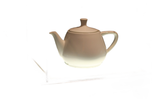
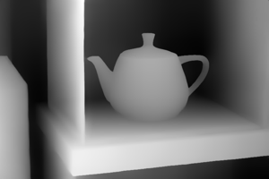

# Brief 2: documenting work and guiding a gallery — what happened when we tried it

Tried on 2026-10-24 with Variable Machine v0.2 (M1 Pro, 32GB; 16GB-tier training settings unless noted). Every step is a real command; the files are in this folder.

**The idea in one line:** your notes about a work become a wall label in the house voice; the photo becomes a cut-out, a depth map, and a description; the label becomes a recording for an audio guide.

There was no student's own writing to train on, so the stand-in is the **Cleveland Museum of Art's open-access collection** (all data CC0, including its curatorial descriptions): 180 paintings with title, artist, date, medium, size and label, in [cma-paintings.csv](cma-paintings.csv). The Art Institute of Chicago's API, the first choice, refused requests (403) on the day.

## What we did, step by step

### 1. A spreadsheet of your works → a dataset · the importer can't do it alone

A student's spreadsheet has a column per fact plus the label. `data import file uploads/cma-paintings.csv …` refused it:

> couldn't tell which columns are the question and the answer. columns: title, artist, date, medium, size, label

`data template` *can* join columns ("{title}, {artist}, …"), but only for tables fetched from a web address into `workspace/raw`, not for your own file. So the columns were joined in the spreadsheet with one formula into two columns, `input` and `output`, and that imported:

```
data import file uploads/cma-labels.csv cma-labels --license "CC0 (Cleveland Museum of Art open access)"
data split cma-labels --valid 0.1          162 train · 18 valid · about 165 tokens a row
```

### 2. Facts → label: the brief's rows, trained · 102 seconds

```
train cma-labels-360m --data cma-labels --base HuggingFaceTB/SmolLM2-360M-Instruct --iters 200 …
```

Set-aside loss: 3.16 → **2.75 at step 50 → 3.59 at step 200**: it went *up* after one pass through the data, memorising. 50 steps was the better stop.

Then the real problem, on works it hadn't seen: every model invented what the painting shows. Given "A Builder of Boats, John George Brown, c. 1904, oil on canvas", the trained model wrote about boats "painted for the 1893 Chicago World's Fair" and the 1904 Paris World's Fair. **Title, date and medium don't say what's in a work or why it matters, so no model can write a true label from them.** The brief's rows (facts → label) can't work.

### 3. Facts + your notes → label · the version that can

Each input got the student's notes added, a few words about what to say ([cma-labels-notes.csv](cma-labels-notes.csv); here the stand-in notes are eight content words taken from each real label):

```
Title: St. Matthew | Artist: William Blake (British, 1757–1827) | Date: 1799 | Medium: tempera on canvas
My notes: energy, evangelist, Matthew, responds, presenting, divinely, inspired, echoes
```

| model | how | time to make | what it wrote for St. Matthew |
|---|---|---|---|
| SmolLM2-360M, trained 100 steps | Train | 1 min | invents ("a vision Blake experienced during a trip to Italy") |
| **SmolLM2-1.7B, trained 100 steps, batch 1** | Train | 83 s | "The energy of the evangelist Matthew responds to the divine inspiration of the divine message…" (close to the notes; still adds a little elsewhere) |
| qwen3:4b, two example labels in a Modelfile ([label-writer-qwen.Modelfile](label-writer-qwen.Modelfile)) | Modelfile, no training | 1 min | "St. Matthew, the evangelist, responds with energetic grace to divinely inspired vision." (keeps to the notes, stiff, **56–126 seconds a label**) |

qwen3:4b only works with thinking *on*: with `think` off it writes its reasoning into the answer and runs out of room before the label.

### 4. Prefer: pick the better draft · 100 seconds, too few pairs to tell

Asked the 1.7B label writer for two drafts of each of 36 works, and chose the one that added fewer words not in the facts or notes (a stand-in for a student choosing). 17 of the 36 pairs were too alike to choose between, leaving **19 pairs**:

```
data new label-prefs --format preference
data append label-prefs '{"prompt": …, "chosen": …, "rejected": …}' --source label-writer-notes-1.7b     (×19)
data split label-prefs --valid 0.2          15 train · 4 held out
prefer label-writer-prefer --data label-prefs --model workspace/fused/cma-notes-1.7b --iters 60 --lr 2e-5 --sft 1
```

Held out: prefers the chosen draft in 3 of 4 before, 3 of 4 after. Four pairs can't show a change; the haiku example needed 44.

### 5. Photos: cut-out and depth (the image segmentation tab) · 3 seconds each

```
look cutout images/classic-cv/utah-teapot.jpg       3.1 s
look depth images/classic-cv/utah-teapot.jpg        2.7 s
```

 

The depth map is clean. The cut-out kept the teapot, but also part of its lit glass base, and faded the white teapot's bottom into it: light, shiny work on a light ground needs a plain contrasting background when you photograph it.

### 6. Describe from the photo (SmolVLM)

Done when the sees kind was built ([docs/releases.md](../../releases.md), v0.1.5): `data picture` for 16 rows over 4 photos, `train` 60 steps (loss 5.1 → 0.01, about 2.5 minutes with the download), `export`, and in Chat the trained model answers with its labels where the base writes paragraphs. With only four photos it recites the labels it learned; on a picture it hadn't seen it only partly picked up the style.

### 7. The audio guide: label → voice · found a bug, fixed

```
ollama run-once cvl-causal-60 --image images/classic-cv/stanford-bunny.jpg "What is this?"     4 s
speak stanford-bunny-label "Stanford bunny, 1994. A 3D print of …" --set audio-guide             10 s
listen audio/audio-guide/stanford-bunny-label.wav
```

The recording was **41 seconds** long for an 11-second label, with long humming where "A 3D print of a scanned clay rabbit" should be. Speaking that one sentence again and again: it came out right 1 time in 3; the other 2 ran to the 32.8-second limit. Soprano was sampling and sometimes never reached its "stop". Lower temperature didn't help; **greedy decoding (temperature 0) finished every sentence, every time**, at about 15 characters a second. `speak` now does that (commit a562b6e). After the fix: 11.2 seconds, three times out of three: [stanford-bunny-label.wav](stanford-bunny-label.wav). Listening back is the check: `listen` heard "…Greg Turk and Marc Lavois scanned it at Stanford" (it is Levoy).

## Reproduce it

Everything above, in order, as you would type it. `VM ›` lines go in Variable Machine's terminal (the line at the bottom of the app); `$` lines go in a Terminal window, in the `variable-machine` folder. The app must be open in the browser for `look` (it runs in the page). About 15 minutes, most of it the 1.7B training and its first download (3.4GB). **Free disk space: at least 8GB**: exporting the 1.7B model writes a 3.2GB copy and a 1.9GB Ollama model, and with less the export stops with "Unable to write … bytes to file". Runs are repeatable: the same commands gave the same losses, to three decimals, on two runs.

**Starting over** (only if you've run this before; each line moves the old one to the Trash):

```
VM › trash data/cma-labels
VM › trash data/cma-labels-notes
VM › trash data/classic-cv-labels
VM › trash adapters/cma-labels-360m
VM › trash adapters/cma-notes-1.7b
VM › trash adapters/cvl-causal-60
VM › trash fused/cma-labels-360m
VM › trash fused/cma-notes-1.7b
VM › trash fused/cvl-causal-60
VM › trash audio/audio-guide
```

**1–2. Facts → label (the version that can't work).** [cma-labels.csv](cma-labels.csv) is the spreadsheet with its fact columns already joined into `input`.

```
$ cp docs/briefs/2-gallery/cma-labels.csv docs/briefs/2-gallery/cma-labels-notes.csv workspace/uploads/
VM › data import file uploads/cma-labels.csv cma-labels --license "CC0 (Cleveland Museum of Art open access)"
VM › data split cma-labels --valid 0.1
VM › train cma-labels-360m --data cma-labels --base HuggingFaceTB/SmolLM2-360M-Instruct --type lora --rank 8 --layers 8 --lr 1e-4 --iters 200 --batch 4
VM › export cma-labels-360m --name label-writer --quantize int8
$ python3 docs/briefs/2-gallery/check-labels.py label-writer cma-labels
```

Expect: 180 rows, **162 train · 18 valid**; the set-aside line **3.16 → 2.75 (step 50) → 3.02 → 3.24 → 3.59 (step 200)**, going up after step 50; and about **33 names not in the facts** over the 18 works it hadn't seen (it invents fairs, patrons, trips). [check-labels.py](check-labels.py) prints every draft under its facts: read a few aloud.

**3. Facts + notes → label (the version that can).**

```
VM › data import file uploads/cma-labels-notes.csv cma-labels-notes --license "CC0 (Cleveland Museum of Art open access)"
VM › data split cma-labels-notes --valid 0.1
VM › train cma-notes-1.7b --data cma-labels-notes --base HuggingFaceTB/SmolLM2-1.7B-Instruct --type lora --rank 8 --layers 8 --lr 1e-4 --iters 100 --batch 1
VM › export cma-notes-1.7b --name label-writer-notes-1.7b --quantize int8
$ python3 docs/briefs/2-gallery/check-labels.py label-writer-notes-1.7b cma-labels-notes
```

Expect: the same 162 · 18 split; the set-aside line **2.83 → 2.21 (step 50) → 2.16 (step 100)**, about 70 seconds; about **14 names not in the facts or notes**, less than half. St. Matthew begins "The energy of the evangelist Matthew responds…" and still adds "the Holy Spirit".

The Prefer step (4) is left out: with 19 pairs it showed no change, so it's not worth a class's time until there are 40+.

**5. Photos: cut-out and depth.**

```
VM › look example classic-cv
VM › look cutout images/classic-cv/utah-teapot.jpg
VM › look depth images/classic-cv/utah-teapot.jpg
```

Expect (`look example` says "already here" if you have the photos; that's fine): two pictures in `workspace/outputs/` in about 3 seconds each, like [teapot-cutout.png](teapot-cutout.png) and [teapot-depth.png](teapot-depth.png): the cut-out keeps part of the glass base.

**6. Describe from the photo: a picture model.** Four photos, four questions each, the same label every time:

```
VM › data picture classic-cv-labels images/classic-cv/duck-in-a-bowl.jpg --question "Describe this picture." --answer "Rubber duck in a glass bowl, undated. Vinyl, glass and water. The curved glass and the water bend the light around it."
VM › data picture classic-cv-labels images/classic-cv/duck-in-a-bowl.jpg --question "Tell me about this object." --answer "Rubber duck in a glass bowl, undated. Vinyl, glass and water. The curved glass and the water bend the light around it."
VM › data picture classic-cv-labels images/classic-cv/duck-in-a-bowl.jpg --question "What am I looking at?" --answer "Rubber duck in a glass bowl, undated. Vinyl, glass and water. The curved glass and the water bend the light around it."
VM › data picture classic-cv-labels images/classic-cv/duck-in-a-bowl.jpg --question "What is this?" --answer "Rubber duck in a glass bowl, undated. Vinyl, glass and water. The curved glass and the water bend the light around it."
VM › data picture classic-cv-labels images/classic-cv/rubber-duck.jpg --question "Describe this picture." --answer "Rubber duck, undated. Yellow vinyl, beside a laptop. Programmers explain their code to it line by line and often find the bug while talking: rubber-duck debugging."
VM › data picture classic-cv-labels images/classic-cv/rubber-duck.jpg --question "Tell me about this object." --answer "Rubber duck, undated. Yellow vinyl, beside a laptop. Programmers explain their code to it line by line and often find the bug while talking: rubber-duck debugging."
VM › data picture classic-cv-labels images/classic-cv/rubber-duck.jpg --question "What am I looking at?" --answer "Rubber duck, undated. Yellow vinyl, beside a laptop. Programmers explain their code to it line by line and often find the bug while talking: rubber-duck debugging."
VM › data picture classic-cv-labels images/classic-cv/rubber-duck.jpg --question "What is this?" --answer "Rubber duck, undated. Yellow vinyl, beside a laptop. Programmers explain their code to it line by line and often find the bug while talking: rubber-duck debugging."
VM › data picture classic-cv-labels images/classic-cv/stanford-bunny.jpg --question "Describe this picture." --answer "Stanford bunny, 1994. A 3D print of a scanned clay rabbit. Greg Turk and Marc Levoy scanned it at Stanford; its mesh became a standard test model in computer graphics."
VM › data picture classic-cv-labels images/classic-cv/stanford-bunny.jpg --question "Tell me about this object." --answer "Stanford bunny, 1994. A 3D print of a scanned clay rabbit. Greg Turk and Marc Levoy scanned it at Stanford; its mesh became a standard test model in computer graphics."
VM › data picture classic-cv-labels images/classic-cv/stanford-bunny.jpg --question "What am I looking at?" --answer "Stanford bunny, 1994. A 3D print of a scanned clay rabbit. Greg Turk and Marc Levoy scanned it at Stanford; its mesh became a standard test model in computer graphics."
VM › data picture classic-cv-labels images/classic-cv/stanford-bunny.jpg --question "What is this?" --answer "Stanford bunny, 1994. A 3D print of a scanned clay rabbit. Greg Turk and Marc Levoy scanned it at Stanford; its mesh became a standard test model in computer graphics."
VM › data picture classic-cv-labels images/classic-cv/utah-teapot.jpg --question "Describe this picture." --answer "Utah teapot, 1974. Glazed white ceramic. Martin Newell measured this Melitta teapot to make one of the first 3D computer models; it became the test object of computer graphics."
VM › data picture classic-cv-labels images/classic-cv/utah-teapot.jpg --question "Tell me about this object." --answer "Utah teapot, 1974. Glazed white ceramic. Martin Newell measured this Melitta teapot to make one of the first 3D computer models; it became the test object of computer graphics."
VM › data picture classic-cv-labels images/classic-cv/utah-teapot.jpg --question "What am I looking at?" --answer "Utah teapot, 1974. Glazed white ceramic. Martin Newell measured this Melitta teapot to make one of the first 3D computer models; it became the test object of computer graphics."
VM › data picture classic-cv-labels images/classic-cv/utah-teapot.jpg --question "What is this?" --answer "Utah teapot, 1974. Glazed white ceramic. Martin Newell measured this Melitta teapot to make one of the first 3D computer models; it became the test object of computer graphics."
VM › data split classic-cv-labels --valid 0.25
VM › train cvl-causal-60 --data classic-cv-labels
VM › export cvl-causal-60
VM › ollama run-once cvl-causal-60 --image images/classic-cv/stanford-bunny.jpg "What is this?"
```

Expect: **12 train · 4 valid**; the set-aside line **2.19 (step 20) → 0.39 → 0.014 (step 60)**, about 2.5 minutes (longer the first time: a 0.5GB download); the answer is the bunny's label word for word, in about 3 seconds. Ask the model you started from the same thing, `ollama run-once smolvlm:256m --image images/classic-cv/stanford-bunny.jpg "What is this?"`, and it says "Toy rabbit.": the training changed what it says, not what it sees.

**7. The audio guide.**

```
VM › speak stanford-bunny-label "Stanford bunny, 1994. A 3D print of a scanned clay rabbit. Greg Turk and Marc Levoy scanned it at Stanford; its mesh became a standard test model in computer graphics." --set audio-guide
VM › listen audio/audio-guide/stanford-bunny-label.wav
```

Expect: a recording of about **11 seconds** ([stanford-bunny-label.wav](stanford-bunny-label.wav)), the same length every time; `listen` writes it back nearly word for word, and the names are where it slips ("Lavois" for Levoy).

## The real instructions (rewritten from what happened)

1. **Write notes for each work, not just facts.** Two columns in a spreadsheet ([cma-labels-notes.csv](cma-labels-notes.csv) is an example): *input* = title, materials, year, size **and three or four notes in your own words about what to say**; *output* = the label you wrote. 40 works at least; 150+ is better. (Joining the columns into *input* is one spreadsheet formula.)
2. **Data → your own file**, then check, count, split.
3. **Train on SmolLM2-1.7B** (on a 16GB Mac, batch 1) for about one pass through your rows: steps ≈ rows ÷ batch. Watch the set-aside line: if it turns up, stop sooner. Export as `my-label-writer`.
4. **Test on works it hasn't seen**, and read every draft against your notes. **It will still add things that aren't in the notes.** It drafts in your voice; you check every fact.
5. **Prefer:** ask for two drafts of each of 40+ works and pick the one that stays truer to the notes. Fewer than about 40 pairs won't show a change.
6. **Photos (image segmentation tab):** photograph each work on a plain background that contrasts with it, then cut-out and depth.
7. **Describe from photos (Data → picture, then Train):** at least 15–20 different works, a few questions each; with four it only recites.
8. **Voice:** speak each approved label, then **listen to every recording** (or run `listen` on it) before it goes on a wall. Names are where it slips.

## What Variable Machine needs, found by doing this

- **"Your own file" with more than two columns:** let `data template` read an uploaded spreadsheet, so the facts and notes columns become the question without a formula.
- **A loss reading that says "stop at step 50"** when the set-aside line turns up, and offers that number for the next run.
- **"Two drafts, pick one"** on Chat or Adapters, feeding a preference set directly (pairs here were made with a script).
- **Batch voice:** speak every label in a dataset or a CSV column, one sound per row, each listened back automatically and flagged when what was heard doesn't match.
- **The visitor side** (a show page with each work's label and recording, a QR code per work, search by description) is outside Variable Machine today.
