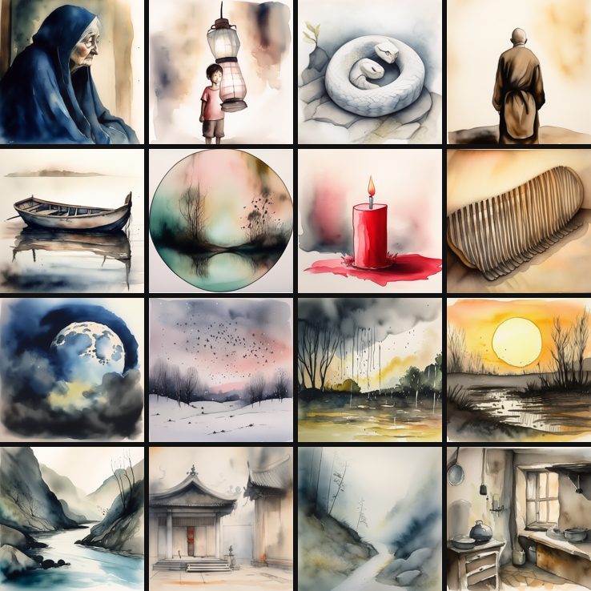

# Dream reading: plan

A Projects card for a student's installation. The student is Taiwanese; she uses she/her. First built 2026-11-11; rebuilt 2026-11-20 on Kevin's brief:

> Her structure is Who, What, When, Where, from human choice, and now it is 4 cards per 4 qualities. The different combinations should be interpreted. Then she can choose which text to add as the guide to interpreting, including her own, or others she can upload; then we should use a diffusion model to generate variations of those combinations. However many models we need, there should be choice.

**Card name:** *dream reading · who, what, when, where*. It follows the walkthrough the research bot has (project mode): the Start map unfolds into the dream's schematic, the decisions come first, then every step on one long page.

The sources are in [`dream-reading.md`](dream-reading.md). The models are Kandinsky 2.2 (loaded by `latent.py`, as the latent image card does), its prior, SigLIP, and two models in Ollama.

## 1. The words

| Word | What it is |
|---|---|
| **quality** | one of who (誰), what (什麼), when (何時), where (何地) |
| **card** | one picture standing for a quality |
| **deck** | the sixteen cards: four for each quality |
| **combination** | one card of each quality. 4 × 4 × 4 × 4 = 256. Named by its cards' numbers, who-what-when-where: `1-3-2-4` |
| **guide texts** | the texts the combinations are interpreted with, chosen by the student: dream books, other texts, her own writing |
| **passage** | a piece of a guide text, about a paragraph; for the *Zhougong jiemeng*, one line (a dream and its omen) |
| **interpretation** | what a language model writes for a combination, from the passages nearest its four cards, in English and Traditional Chinese |
| **variation** | a picture a diffusion model draws for a combination |
| **the room** | the full-screen page the installation shows |

## 2. The interaction

1. The room shows the deck as four rows, one per quality, four cards in each.
2. The visitor thinks of a dream and touches one card in each row. They can type a few words of it, or not.
3. They press **read my dream**. The room shows the four cards chosen, the combination's variations, and its interpretation.
4. **another dream** clears the choice for the next visitor.

## 3. The route, and its decisions

Each decision changes a step's command, or which steps there are.

| Decision | Options | What it changes |
|---|---|---|
| **Where the cards come from** | her own pictures (four image sets, uploaded in step 2); a demo deck drawn from prompts | step 2: upload, or `dream cards dream-demo` |
| **The guide texts** (any number) | the *Zhougong jiemeng*, Wang Fu's "Meng lie", the *Liezi* in Chinese and in English, Zhuangzi, Freud, Jung, *Kuunmong*, Wikipedia's "Dream incubation"; her own texts, uploaded as .txt or .md | step 4 brings in the missing ones; step 5 cuts them all into passages |
| **Which models read** | the writer: `qwen3:4b`, `qwen3:1.7b`, or none (the passages alone); the passage finder: `nomic-embed-text` or `mxbai-embed-large` | steps 1, 5, 6, 7 |
| **How variations are drawn** | the four cards mixed; or the cards and the interpretation, through Kandinsky's prior | steps 1 (the prior), 6, 7 |
| **How many variations** | 1, 2 or 4 a combination | steps 6, 7 |
| **When** | all 256 before the show (and any missing, in the room); or in the room only | step 7 is there or not |
| **The visitor's words** | kept beside the response; or read into a new interpretation, live | the room's `dream respond` |

**The default route:** the demo deck; the *Zhougong jiemeng*, Wang Fu and the *Liezi* (Giles) as guide texts; `qwen3:4b` and `nomic-embed-text`; variations from the cards, two each; all 256 ahead; the visitor's words kept.

| # | Step | Box | Command |
|---|---|---|---|
| 1 | get the models | models | `model get kandinsky`, `model get siglip`, `model get kandinsky-prior` (if the demo deck or the prior is chosen), `ollama pull nomic-embed-text`, `ollama pull qwen3:4b` |
| 2 | the cards | cards | her own: upload four sets in the step; or `dream cards dream-demo` |
| 3 | the deck | deck | `dream deck dream --who images/<set> --what … --when … --where …` |
| 4 | the guide texts | guide texts | `data raw txt …` for each library text not brought in yet; her own texts uploaded in the step |
| 5 | the passages | passages | `dream guide dream raw/zhougong-jiemeng raw/wangfu-menglie raw/liezi-dreams [uploads/<her text>.txt]` |
| 6 | one combination | interpret | `dream interpret dream --combination 1-1-1-1`, `dream draw dream --combination 1-1-1-1`; the step lets her pick any combination and read it |
| 7 | all of them | variations | `dream interpret dream --all`, `dream draw dream --all` |
| 8 | the room | the room | `dream choose dream --who 1 --what 2 --when 3 --where 4`, `dream respond dream`; then open the room |

Every step is a real command, shown on the step and run from it.

## 4. The cards

**Her own pictures** are the work. She uploads four image sets in step 2, one per quality; the first four pictures of each are its cards. A set may have more; only four are dealt.

**The demo deck** is for trying the card before her pictures are in. Kandinsky 2.2's prior turns a written prompt into Kandinsky's 1280 numbers, and its decoder draws them. The prompts (`DEMO` in `dream.py`) share one style ("ink and watercolour on paper, soft light, quiet, a single subject, dreamlike"), so the sixteen read as one deck. Each prompt names something the glossary has, so the *Zhougong jiemeng* has lines for it:

| who | what | when | where |
|---|---|---|---|
| an old woman in a dark blue robe | a small wooden boat on still water | a full moon behind clouds at night | a river between mountains |
| a child holding a paper lantern | a round bronze mirror | snow falling at dusk | a temple courtyard with incense smoke |
| a white snake coiled on a stone | a lit red candle | heavy summer rain | a mountain path in mist |
| a monk seen from behind | a wooden comb lying on silk | the sun rising at daybreak | an old kitchen with a clay stove |

**The deck step** encodes every card twice:
- by Kandinsky's picture encoder, into 1280 numbers, for drawing;
- by SigLIP, which puts pictures and English phrases in one space. It finds each card's three nearest words in a glossary of about 140 characters (`GLOSSARY` in `dream.py`), each set under its quality: 蛇 *a snake*, 鏡 *a mirror*, 月 *the moon*, 寺 *a temple*.

## 5. Interpretation: "trained on dream interpretation", honestly

Nothing is trained. The interpretation is **retrieval and reading**:

1. **The *Zhougong jiemeng*** (周公解夢, 988 lines, public domain) is looked up through the glossary: for each card, the book's lines whose dream holds that card's characters. 蛇入門主得財: "a snake comes in at the gate: you will gain wealth".
2. **Every other guide text** is cut into passages and measured by an embedding model in Ollama (`nomic-embed-text`, Apache 2.0, 274 MB). A combination's four cards, in words, find the nearest passages: two from each text, eight in all.
3. **A language model** (`qwen3:4b`, Apache 2.0) is given the four cards and the numbered passages, and writes:
   - five sentences in English, reading the four cards together as one dream and saying which text each idea comes from;
   - the same in Traditional Chinese (left out if it comes back partly in English, as it did once in testing);
   - one **picture sentence**, for the drawing;
   - the numbers of the passages it used.
4. Each combination's page prints all of it: the cards, the variations, the interpretation, and every passage, the ones used marked.

**Her own writing is a guide text like any other.** Uploaded as .txt or .md, it is cut into passages at paragraph breaks and found the same way. That is how she makes the interpretation hers: the more of her own writing, the more of the reading comes from her.

**Why not train a model on dream interpretation:** there is no honest data set for it. A model trained on a dream book would learn to produce omens in the book's style, not to read; the retrieval keeps every sentence traceable to a passage.

**Limits:**
- The passages are found by how near their words are to the cards' words, not by understanding. Eight passages is what fits a small model's attention.
- The glossary decides what the *Zhougong jiemeng* can see in a card.
- `qwen3:4b` reasons at length unless the prompt ends with `/no_think` (Ollama's `think: false` was ignored when tested).

## 6. Variations: the diffusion model, two ways

| | the four cards, mixed | the cards and the interpretation |
|---|---|---|
| How | the cards' Kandinsky numbers, mixed. Variation 1 is led by who (40%, the other three 20% each), variation 2 by what, and so on | the same mix, with the interpretation's picture sentence turned into Kandinsky's numbers by the prior and mixed in at 40% (`interpolate`, in diffusers) |
| Needs | Kandinsky (9 GB) | Kandinsky and its prior (6.9 GB more) |
| Shows | the combination's pictures, condensed into one | the same, shaped by what the reading says |
| Time | about 20 s a picture | about 20 s a picture, plus the prior |

All 256 at two variations is 512 pictures: about 3 hours. The command can stop and start again: what is drawn is kept.

**Other diffusion models, not built:** a LoRA trained on her cards (`latent train` does it for the latent image card) would draw the variations in her own look; it is the next step once her pictures are final. Larger models (FLUX.1 schnell, Apache 2.0, about 24 GB) don't fit a 16 GB Mac.

## 7. When: ahead, and live

**Ahead** (the default): `dream interpret dream --all` (about 25 s a combination, 2 hours for 256) and `dream draw dream --all` (3 hours). She reads the pages and redoes any she doesn't keep, combination by combination, with step 6.

**Live:** in the room, `dream respond` shows what was made ahead at once, and makes anything missing (about a minute). With "read the visitor's words", a visitor who types words gets a new interpretation written with them (about 30 s).

## 8. The room

- `http://localhost:4817/#room/dream` (4843 in testing): black, full screen (the browser's full-screen key), no other part of the app.
- It runs the card's own commands, `dream choose` and `dream respond`, with the decisions made on the card in the same browser.
- Hardware: the laptop runs Variable Machine; a second screen or projector shows the room. A touch screen works as it is.
- Privacy: a visitor's words are kept in `workspace/dreams/dream/choice.json` and the responses, on the laptop only. All the models run locally.

## 9. The build

**New or rewritten (2026-11-20):**

- `python/variable_machine/dream.py`: `cards`, `deck`, `guide`, `interpret`, `draw`, `respond`, and each combination's page. It imports Kandinsky's encoder, decoder and `draw` from `latent.py`, and SigLIP from `mood.py`.
- `helper/src/dream.ts`: the `dream` commands; `model get kandinsky-prior` (`helper/src/shared/kinds.ts`).
- `ui/src/components/DreamMode.tsx` (the schematic and the decisions), `DreamViews.tsx` (each step's own view: the cards and their uploads, the deck, the guide texts and their uploads, one combination, the room), `DreamRoom.tsx` (the room), `ui/src/lib/dreamChoices.ts` (the decisions, kept in the browser).
- The route in `ProjectsPanel.tsx` (`dreamRoute`); the words in `projects.md`.
- This branch merges `claude/roll-your-own` for the walkthrough (project mode), which isn't on main yet.

**Replaced:** the first version (2026-11-11) had one card for each quality and a visitor choosing one of four. Its single picture and reading for one card are what a combination's interpretation and variations now do for four.

**Tested** on port 4843, 2026-11-20, every command through the tool: `model get kandinsky-prior` (6.4 GB onto KP 512, linked from `workspace/tools/`); `dream cards dream-demo` (16 cards, 6 minutes, 16 s a card); `dream deck` and `dream guide` with the Zhougong jiemeng, Wang Fu and the Liezi (Giles); combinations interpreted one at a time and with `--all` (19 to 32 s each), stopped with the page's stop and started again (the eight made were kept); variations drawn from the cards and through the prior (20 s each); the walkthrough's decisions and steps; and the room, with a combination made ahead (about 10 s) and one made live with a visitor's words (about 90 s).

What testing changed:
- the first prompt had the model list the cards' omens one by one, three times over, from the dream book alone. It now asks for one sentence for each guide text and one joining them, which uses all three texts;
- the dream book's lines took every place for passages (two a card); now one a card, so the other texts are heard;
- diffusers' `interpolate` takes a tensor as a picture's pixels, not as Kandinsky's numbers, so the mix with the sentence is done in `dream.py`;
- a Chinese sentence with English words in it is left out, not the whole reading;
- a card with a title is described by its title alone: SigLIP's second and third words can be wrong (an ox for the snake), and the model repeated them.

**Not built:** a LoRA on her cards; a server that keeps Kandinsky loaded between visitors (each response loads it, about 25 s); editing an interpretation by hand in the page (she can edit `interpretation.json`, and the room shows it).

## 10. The second card: dream reader, trained

Added 2026-11-20, on Kevin's brief after seeing the room:

> I love that we have a version of the final, and the Kandinsky model is awesome. But we want the user to be able to make all the combinations themselves, as well as making the choices about which models to use, how to train them with the texts we have, and the different diffusion models as well. Then maybe providing possible output styles from someone's own drawings.

The first card (*dream reading*) stays as it is: it is the installation made with ready-made models. The second card, **dream reader, trained · 訓練解夢**, makes the same installation with models the student trains, through Variable Machine's own tabs, as the research bot's card does. It shares the dream folder, the deck and the guide texts with the first card.

**The words it adds.**
- The **teacher** is the ready-made language model (qwen3:4b by default) that interprets every combination first.
- A **row** is one training example: the question `dream interpret` asked (the four cards and the nearest passages, in full) and the teacher's answer, as JSON.
- The **reader** is the small model she trains on the rows she keeps and exports to Ollama: her dream reader.
- A **style** is a latent image of someone's own drawings, trained with `latent train`: a LoRA (a small set of added weights) for Kandinsky's decoder, so it draws in their look.

**The route** (14 steps; 13 with no style):

| # | Box | Command | What it makes |
|---|---|---|---|
| 1–5 | models, cards, deck, guide texts, passages | the first card's own | the deck and the guide texts |
| 6 | interpret | `dream interpret dream --all --model qwen3:4b` | all 256 readings by the teacher, each keeping its question and answer |
| 7 | rows | `dream rows dream dream-readings [--keep]`, `data split dream-readings --valid 0.2` | the readings as drafts to keep, edit or reject on the Data tab (or, with `--keep`, kept unread) |
| 8 | train | `train dream-reader --data dream-readings --base Qwen/Qwen2.5-0.5B-Instruct --max-seq 3072` | the reader (a LoRA on the base) |
| 9 | export | `export dream-reader` | the reader in Ollama |
| 10 | interpret | `dream interpret dream --all --again --model dream-reader` | all 256 readings again, by her reader |
| 11 | drawings | `[dream drawings demo-drawings]`, `latent make her-style images/her-drawings`, `latent train her-style` | the style |
| 12 | variations | `dream draw dream --all --style latents/her-style [--again]` | every combination drawn in the style |
| 13 | the room | `dream choose …`, `dream respond dream --model dream-reader --style latents/her-style` | `#room/dream/trained`: the room with her reader and style |
| 14 | package | `package dream-reader`, `zip packages/dream-reader` | the reader, its rows and their sources, to share |

**The decisions it adds:** the teacher (qwen3:4b or qwen3:1.7b); the reader's base; whether every row is read before it is kept; which diffusion model draws; whose style.

**The reader's base.** Variable Machine trained SmolLM2 only, which writes English. The reading is in English and Chinese, so two Apache 2.0 bases that write Chinese were added to the training bases (`helper/src/shared/library.ts`): Qwen2.5 0.5B Instruct (the default) and 1.5B Instruct. Qwen2.5 3B is under the Qwen Research licence, so it is not offered. `--max-seq 3072`: a row is about 2,000 tokens (4,700 characters of question, with the Chinese answer).

**The diffusion models.** Kandinsky 2.2 is the one that can be trained here (`latent train`), from the cards or with the prior. Stable Diffusion 1.5 (CreativeML OpenRAIL-M, words only) and FLUX.1 schnell (Apache 2.0, 12 billion weights) are listed as choices with why they are not offered yet: the first needs its own drawing and style training; the second is too big to train a style on with 32 GB.

**The demo drawings.** `dream drawings demo-drawings` draws 30 drawings in one ink line style with Kandinsky (Apache 2.0 output), standing in for someone's own until theirs are uploaded at step 11. Thirty, so the latent image has its axes. A style trained on Kandinsky's own pictures is a test of the route, not of a style: it should be made from a person's drawings.

**New:** `dream rows`, `dream drawings`, `--again` (interpret and draw), `--style` (draw and respond), the readings' `asked` and `answer`, the manifest's `byModel` and `styled`; `trainedRoute` in `ProjectsPanel.tsx`; the trained boxes, wires and decisions in `DreamMode.tsx`; the drawings view in `DreamViews.tsx`; the trained room (`#room/<name>/trained`).
