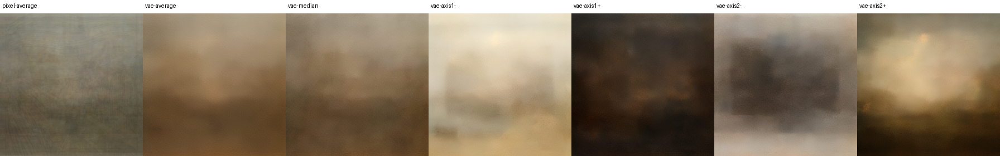
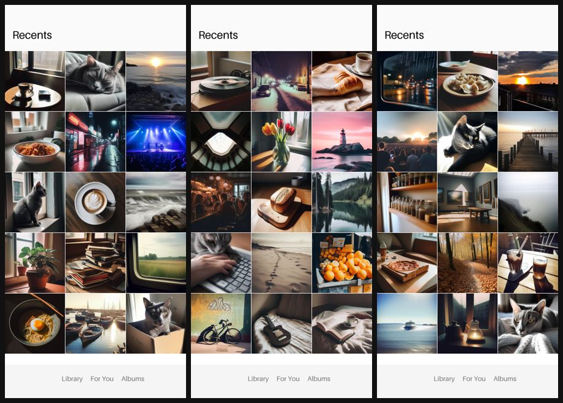
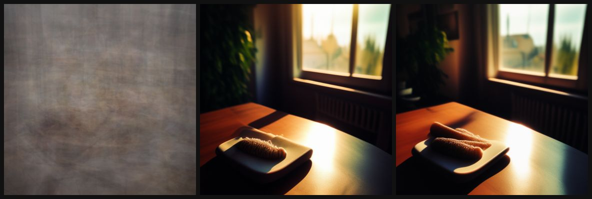
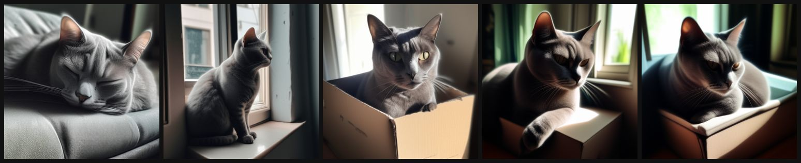
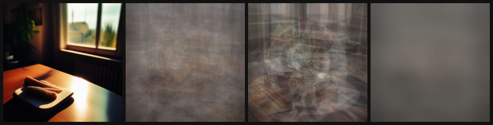
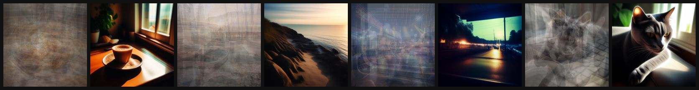
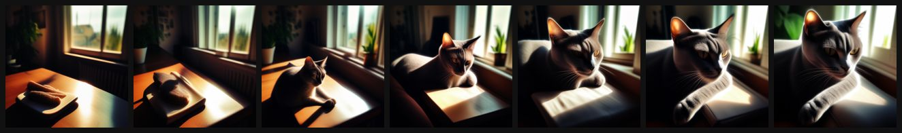
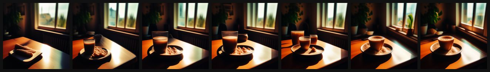

# The latent image of a collection: plan and sources

A Projects card for a student's thesis: train on the images a person keeps, make the collection's latent image from what the model learned, then measure a gallery against it. Written 2026-11-04; revised and built 2026-11-05, after Kevin allowed a larger model and some bending of the usual limits for this card. Licences were checked against the sources themselves.

**The latent image** of a collection is the picture the collection holds without any one image in it showing it. Kevin's words for it are the collection's "subconscious" or "pre-cognitive" picture. Here it is made statistically: it is the centre of what a model learned from all the images, made back into a picture.

**Card name:** *latent image*. On the card: **latent image · what a collection holds that no single image shows**.

This replaces the image-mood plan. That card, its commands and its result are on this branch in commit c58301a, not merged. Section 7 says what carries over.

**What changed on 2026-11-05.** The first version of this plan (commit 583660c) kept to an 8 GB Mac and recommended a 10 MB autoencoder (TAESD). Kevin then allowed a larger model. A fifth way, (5) below, was prototyped on this Mac and is far better: its latent image is a picture, not a blur. It is what the card is built on. It bends three of the usual limits, on purpose:

- **Download:** 9 GB (Kandinsky 2.2), against the usual ask-above-1-GB. On Kevin's machine it goes to KP 512 with the rest of his install.
- **Memory:** it needs a 16 GB Mac (it peaks at about 8 GB, 9 GB to train), not 8 GB. The helper refuses below 15 GB and says why.
- **Install:** torch and diffusers, about 1 GB in the python project's `latent` extra.

TAESD, (2) below, is the way to do it on an 8 GB Mac. It was built on 2026-11-24: `latent make <name> images/<set> --with taesd` (section 3, (2), says what it does).

## 1. What the latent image is not

- It is not a memory or an unconscious in any literal sense. It is a mean and a few directions of spread, measured in a model's numbers. "Subconscious" and "pre-cognitive" are the thesis's frame, and the texts in section 4 give that frame its history. The card states this in its **what it can't do** line.
- It is not a portrait of the person. A collection of family photos gives a latent image with faces in it. Averaging faces is not reading what anyone feels, so the EU AI Act line from the mood plan doesn't apply. Galton made composites like this to argue for eugenics; the card's sources say so.

## 2. Images

The thesis's images are **the person's own**: a folder of phone photos or a body of work, brought in on the image segmentation tab (upload, or `look example`). Nothing is downloaded for them, and their licence is the person's.

To test without anyone's private photos, use a collection that is one person's work or one subject:

| Collection | Licence | Size | How |
|---|---|---|---|
| Art Institute of Chicago, public-domain works | CC0 (the API's own `license_text`; descriptions, not used, are CC BY) | 40–100 images by search, about 200 KB each at 843 px | `look museum "<artist or subject>" <set> --limit 100` (built in c58301a) |
| Cleveland Museum of Art open access | CC0 per record (`share_license_status`) | by search | `openaccess-api.clevelandart.org/api/artworks/?q=…&cc0=1&has_image=1` (not built) |
| The Met open access | CC0 (`isPublicDomain`) | by search | `collectionapi.metmuseum.org/public/collection/v1.1/search` (the v1 search was retired 2026-10-01); not built |

The test so far used 40 AIC landscapes (CC0) and, for contrast, 513 mixed OASIS photos. OASIS is research-only, so it is not for the final test; see the mood plan's notes.

## 3. Five ways to make it, from plain statistics to a large model

The first four were weighed for an 8 GB Mac; the first two were prototyped on this Mac (M1 Pro, 32 GB) on 2026-11-04. The fifth was prototyped and built on 2026-11-05. The picture below shows (1) and (2) for the 40 landscapes:

### (1) Pixel average: the baseline

- **How:** crop each image to a square, resize it, and average every pixel. This is Galton's composite, or Jason Salavon's averages.
- **Alignment:** with faces, Galton lined up the eyes. A general collection has nothing to line up, so the only alignment is the square crop.
- **What its latent image looks like:**
  - For the landscapes, a grey-green fog with a faint horizon.
  - For mixed OASIS photos, flat grey-brown.
- **What it means:** the collection's average light and colour, place by place in the frame. It knows nothing about what the images show.
- **Cost:** none. It is numpy, takes seconds and needs no download.

### (2) Average of a VAE's codes, decoded

A **VAE** (variational autoencoder) is a model that squeezes an image into a short code and back.

- **How:** encode each image, take the mean (or median) of the codes, and decode it. Also decode the main axes: the principal components of the codes, at the mean minus and plus two spreads.
- **Which VAE:**

  | VAE | Licence | Size |
  |---|---|---|
  | `stabilityai/sd-vae-ft-mse` | MIT | 335 MB |
  | `madebyollin/sdxl-vae-fp16-fix` | MIT | 335 MB |
  | `madebyollin/taesd` (Tiny AutoEncoder, same code space as Stable Diffusion's VAE) | MIT | **10 MB** |

  TAESD has two files of 4.9 MB each and is about 60 lines of MLX here. The prototype used it.
- **Measured:**
  - 513 pictures at 256 px encoded in 10 s; 1.0 GB peak.
  - 40 pictures in under a second.
  - The code is 32 × 32 × 4.
- **What its latent image looks like:**
  - For the landscapes: a warm, soft scene with light sky over dark ground.
  - For mixed OASIS photos: warm brown fog.
- **The axes** read as the collection's main tensions:
  - Landscapes, first axis: pale, open views against dark, heavy ones.
  - Landscapes, second axis: a framed dark mass against a luminous sky.
  - OASIS, first axis: light against dark. Second axis: orange warmth against blue sky.
  - The first axis holds 15–17% of the spread; the next ones 4–7% each.
- **What it means:** the centre of the collection in a space a model learned from millions of images. It is still an average, so it blurs. The more varied the collection, the more it blurs.
- **Cost:** 10 MB, seconds, any Mac.
- **Built (2026-11-24):** `model get taesd`, then `latent make <name> images/<set> --with taesd`. It runs in torch with diffusers' `AutoencoderTiny`, in the same `latent` extra as Kandinsky, not MLX. Each picture is cropped to a square at 256 px and encoded to 32 × 32 × 4 numbers. The latent image is the mean, decoded; `latent-median.png` is the median, decoded; the axes are the first three principal components at ±2 spreads. The latent folder keeps which model made it, so the gallery, themes and walks use the same one. Themes have no words (words are read in Kandinsky's numbers), walks go to a theme or a picture in a straight line, and the decoder isn't trained.
  - **Measured on 100 Hiroshige prints (CC0), M1 Pro, 32 GB:** the 100 pictures encode in about 3 s; the whole `latent make` (with the pixel average, the composite and Python starting) takes about 60 s; the gallery 15 s; a walk of 12 frames 12 s.
  - **What it looks like:** a warm paper-coloured blur, lighter at the top. The axes run from pale to dark, and from light sky over dark ground to the reverse. The check says the centre is not quite stable across halves (0.946; stable at 0.95) and axis 1 is not (0.60): TAESD's numbers describe where light falls, and a hundred prints differ a great deal in that.

### (3) Embedding statistics (SigLIP, Apache 2.0, already in the tool)

- **How:** take the mean and principal components of the collection's SigLIP embeddings. SigLIP's numbers are about what an image shows (a harbour, a portrait, snow), not where its light falls.
- **What its latent image looks like:** there is no picture. No small, permissively licensed generator turns a SigLIP embedding back into an image:
  - Kandinsky 2.2 (Apache 2.0) decodes image embeddings from a different, larger CLIP encoder (ViT-bigG/14). That is (5) below: it needs 9 GB of its files, not SigLIP's.
  - Stable unCLIP is under OpenRAIL-M, not a permissive licence.

  So this latent image can only be *shown* as the images nearest it, the most typical of the collection, and each axis as the images at its two ends.
- **What it means:** the collection's centre of subject matter. It is a useful second measure beside (2): an image can be near the latent image in look and far from it in subject.
- **Cost:** the 214 MB encoder already built; seconds.

### (4) A small model of your own, trained on the person's images

This is the "based on the training" version.

- **Small VAE on pixels**, in MLX:
  - Measured: 2.2M parameters, 17 ms a step of 32 images at 64 × 64, well under 1 GB.
  - 500 images for 300 passes is about 4,700 steps, about **80 seconds**; at 128 × 128, about 5 minutes.
  - Its latent image is its decoder's output at the centre of its code space: the origin, where its prior is densest.
  - With a few hundred images it is blurrier than (2), because it has learned from far fewer images than TAESD.
- **Small diffusion or flow model:**
  - Not measured; this estimate is from typical small models: a U-Net of about 30M parameters at 64 × 64 needs 50,000–200,000 steps, about 1.5–5 hours here.
  - It needs **thousands** of images. With a few hundred it memorises them and its "centre" is one of them.
  - Its latent image would be a sample drawn with the noise turned down, towards the most likely image.
  - Too slow and too data-hungry for a class session; possible for a thesis with time and a large archive.
- **Small VAE on the TAESD codes**, which combines (2) and (4):
  - The person's model learns their collection in TAESD's code space: 4,096 numbers an image instead of 196,608.
  - Its centre decodes through its own decoder, then TAESD's, at 256 px.
  - Training is as quick as the pixel VAE, and the picture is as sharp as (2).
  - It needs **50 images at the least, 200–1,000 to mean much**. Below that, the plain mean of the codes is as good.
  - A caution: if the model were linear, its centre would simply be the mean of the codes, which is (2). A small nonlinear model's centre differs from that mean, but that difference is not evidence of anything "deeper". The card compares the two and lets the student see.

### (5) A large encoder with a decoder: Kandinsky 2.2 (built)

Kandinsky 2.2 (Sber AI, **Apache 2.0**) is an encoder and a decoder that work in the same space of 1280 numbers:

- **The encoder** is CLIP ViT-bigG/14 (trained by LAION): it puts a picture into 1280 numbers, what it shows and how it looks.
- **The decoder** is a diffusion model of 1.2 billion weights with its own autoencoder (MoVQ): it draws a picture from any 1280 numbers.

So the centre of a collection, which no single picture has, can be drawn. That is what (3) lacked.

- **How:**
  - encode every picture;
  - fit the collection's statistics: the mean and the main axes (principal components) with their spreads;
  - decode the mean, scaled to a typical picture's length, since a mean is shorter than any one picture. That picture is the latent image.
  - Decode each of the first three axes at the mean minus and plus two spreads.
- **Decoding settings** (tested; see the picture below):
  - 30 denoising steps;
  - guidance 2.5, pushing away from the embedding of a plain grey picture.
  - Pushing away from all-zeros instead, as a quick first try did, cast every picture magenta.
- **Files:** `kandinsky-community/kandinsky-2-2-prior`, its image encoder only (3.7 GB); `kandinsky-community/kandinsky-2-2-decoder`, the U-Net (5.0 GB), MoVQ (0.27 GB) and configs. 9.0 GB in all. The prior's own diffusion model and text encoder (6.9 GB) aren't needed.
- **Measured on this Mac (M1 Pro, 32 GB, torch 2.15 on MPS):**
  - 99 pictures encode in 44 s; 513 in 188 s.
  - One 512 px picture decodes in about 16 s; the latent image and its axes, nine pictures, take about 3 minutes.
  - Peak memory is about 8 GB.
- **What its latent image looks like:**
  - **99 Hiroshige prints (CC0):** a whole Hiroshige-like scene: pines, a far mountain, travellers, a boat, a cartouche of text. The axes run from a bird study to a crowded street scene, and from Fuji over water to buildings and people.
  - **40 landscapes (CC0):** a 19th-century tonal landscape, trees against an evening sky.
  - **513 mixed OASIS photos:** a close view of earth and soil. That is the common ground of a camera roll of animals, food, weather and things; the pixel average of the same photos is brown fog. OASIS is research-only, so its picture isn't in this repository.

- **Training the decoder on the collection (the "based on the training" part):**
  - The statistics are fitted to the person's images. The decoder can also learn them: LoRA adds small weights (1.6M, rank 8, on the U-Net's attention) and trains only those, on the collection's own pictures.
  - Measured: 1.2 s a step of 2 pictures at 512 px in the prototype, 1.5 s through the helper (with the page open); 9 GB. 800 steps (16 passes over 100 pictures) took 16 and 20 minutes, plus about 5 minutes to draw the latent image and axes again with the trained decoder.
  - **What it changed, on Hiroshige:** the same centre drawn after training has the prints' scattered inscriptions instead of a boxed cartouche, and their paper tone and finer line. The subject stays; the look moves toward the collection.

- **What it means:** the centre of the collection in a space a very large model learned from hundreds of millions of pictures, drawn by a decoder that turns that space into pictures. It isn't a blur, because the decoder always draws a whole picture. That is also its limit: the decoder fills in what a centre doesn't say, in the manner of the pictures it was trained on. Training it on the collection moves that manner toward the person's own.
- **Cost:** 9 GB download, 16 GB Mac, about 3 minutes to make, about 25 to train and redraw.

### Recommendation (built)

**Main path: (5), Kandinsky 2.2, with its decoder trained on the collection as the second step.**

- It is the only way that gives a picture a reader recognises as the collection's, for a mixed collection as well as a coherent one.
- The statistics are fitted to the person's images, and the decoder then learns their look: that is "train on a person's images and make the latent image from what the model learned".
- **Beside it:** (1), the pixel average, as the baseline, on the same page.
- **(2), TAESD,** is the way to do it on an 8 GB Mac. Built on 2026-11-24 (below, under (2)).
- **(4)** is not built: (5)'s training step does what it was for, better.

## 4. The texts

**Superseded on 2026-11-11 (section 8).** The card now rests on media theory, not psychology; its texts are in [`latent-image-reading.md`](latent-image-reading.md). The dream and psychology texts below, and the 2026-11-09 additions, belong to a different student's dream project and are kept in [`dream-sources-from-latent.md`](dream-sources-from-latent.md).

These texts are on the subconscious, memory and perception, and all are public domain in the US (Project Gutenberg). The table also notes their status outside the US.

| Text | Where | Notes |
|---|---|---|
| Freud, *The Interpretation of Dreams* (Brill translation, 1913) | Gutenberg **66048** | Freud died in 1939 and Brill in 1948, so it is also public domain where the term is life + 70. Freud compares dream "condensation" to **Galton's composite photographs**, three times. That is the thesis's own precedent. |
| Freud, *Psychopathology of Everyday Life* (Brill) | Gutenberg **67332** | as above |
| Freud, *Dream Psychology* (Eder translation) | Gutenberg **15489** | as above |
| Not these: Freud in the Strachey or Riviere translations, e.g. *Group Psychology* (Gutenberg **35877**) | | In copyright outside the US: Strachey died in 1967, so until 2038; Riviere died in 1962, so until 2033 |
| Galton, *Inquiries into Human Faculty* (1883) | Gutenberg **11562** | The source of the composite portrait, written for eugenics. Use it as history, not method. |
| Bergson, *Matter and Memory* (Paul & Palmer translation, 1911) | Not on Gutenberg; Internet Archive `mattermemory01berg` (1919 printing) | Public domain in the US (published before 1931); Bergson died in 1941 |
| Bergson, *Dreams* (Slosson, 1914) and *Creative Evolution* (Mitchell, 1911) | Gutenberg **20842**, **26163** | |
| William James, *The Principles of Psychology*, vol. 1 and 2 | Gutenberg **57628**, **57634** | The chapters on the stream of thought, memory and attention |
| William James, *Psychology: Briefer Course* | Gutenberg **55262** | |
| Goethe, *Theory of Colours* | Gutenberg **50572** | |
| Wikipedia: "Unconscious mind", "Preconscious", "Composite portrait", "Gestalt psychology" | `data raw wikipedia <title> <name>` (built) | CC BY-SA 4.0: credit the article, share alike |

**More texts, added 2026-11-09:** the critique of Freud, Jung and the critique of Jung (Dalal, Fanon), contemporary dream science (Domhoff, Hoel's overfitted brain), writing on images and memory (Benjamin, Warburg, Steyerl), and texts from Korea (*Kuunmong*, the *Samguk yusa*, taemong) and West Africa (Jedrej and Shaw, the Akan) are now in [`dream-sources-from-latent.md`](dream-sources-from-latent.md). Each is marked public domain, open (with its licence) or library.

**How they enter: they don't change the model, and the card says so.** None of the five ways reads text: the encoder is given pictures only, and the trained decoder learns the person's images. So the texts stay as **framing**:

- a reading list on the card, with the Galton–Freud passage quoted;
- passages the student chooses, printed with the latent image on the gallery page, each with its source.

There is one place they could touch the numbers. A CLIP-like encoder can embed a sentence, so the sentences nearest each SigLIP axis could be listed as that axis's "name". In the mood test, SigLIP matched sentences about colour and light and missed abstract ones. James on memory, or Freud on condensation, would be matched almost at random. I'd leave that out rather than make the claim bigger than it is.

## 5. The gallery step

Point it at a folder: the collection itself, or another one ("how close are these museum pictures to my latent image?"). For each image it gives:

- **Distance from the latent image:** in the encoder's 1280 numbers, in units of the collection's own spread, so 1 is a typical picture of it. It also gives the cosine to the centre ("near in subject").
  - Measured: against the Hiroshige latent image, the 40 landscapes range from 0.88 to 2.15. The nearest is a Hiroshige print among them, then a Hokusai; the furthest is a Western *Annunciation*. The prints themselves range from 0.78 to 1.57.
- **The axes it pulls toward:** its position on the first five axes, with sign. Each axis is shown once at the top of the page as its two decoded ends, so "+2 on axis 1" can be seen, not just read.
- **What it brings:** the share of how the image differs from the centre that the first five axes don't explain. High means the image brings something the collection mostly lacks.
  - A heat map, as first planned, needs a model of pixels. This one measures the whole picture, so the map is replaced by a picture: for the images that bring most (4 by default), the latent image with that image's own unexplained part added, decoded. It shows what that image would bring to the centre.
  - Measured: for pictures far from the collection, the unexplained part is most of the picture, so "what it brings" is close to the picture itself in the collection's manner. Against the trained Hiroshige decoder, Munch's *The Scream* comes back as a woodblock-like print on Hiroshige's paper.

**Output:** `workspace/outputs/<set>-<model>/`:

- `gallery.html`, the contact sheet: the latent image (and the trained decoder's, if trained), the pixel average, the axes, and every image with its distance, axes (as bars) and what it brings, sorted from nearest to furthest. It is one file, sandboxed, as in c58301a.
- `latent.json`, with every number above.
- `latent.png`, `axis-<n>-<sign>.png` and `brings-<image>.png`.

## 6. The check

There is no right answer to score against, so the check is whether the statistics hold up. Each is the mean of 20 random splits.

- **The centre across halves:** split the collection in two at random and fit each half. The two centres' cosine should be 0.95 or more. A centre that changes with the half is noise, not the collection's.
- **Axis 1 across halves:** the two halves' first axes should point the same way: their cosine, ignoring sign, should be 0.7 or more. Below that the gallery page says to read the axes as a sketch.
- **Set-aside fit:** set 20% aside and fit the rest. The axes should explain about as much of how the set-aside images differ as of the training images: 0.75 or more of it.

**Measured:**

| Collection | Centre across halves | Axis 1 across halves | Set-aside fit |
|---|---|---|---|
| 100 Hiroshige prints (CC0), through the helper | **0.993**, stable | **0.72**, stable | 0.67 |
| 40 landscapes (CC0), prototype | 0.949, just under | 0.30, not stable | not measured |
| 513 mixed OASIS photos, prototype | 0.993, stable | 0.83, stable | not measured |

- **The centre holds** from about 40 pictures.
- **The axes need about 100.**
- **Set-aside fit is under 0.75 even at 100 prints:** five axes fitted to 80 pictures in 1280 numbers partly fit those 80 pictures themselves. The page reports it rather than hiding it. The axes are a description of this collection, not a law that new pictures will follow.

The 0.75 threshold was set before measuring; it may be too strict for so few pictures in so many numbers.

## 7. The build (done 2026-11-05)

| Step on the card | Tab | Command |
|---|---|---|
| get the picture encoder and decoder (Kandinsky 2.2, Apache 2.0, 9 GB) | Models | `model get kandinsky` |
| bring in the collection | Image segmentation | upload, or `look museum "Utagawa Hiroshige" hiroshige --limit 100` |
| bring in texts, as framing | Data | `data raw gutenberg 66048 freud-dreams`, `data raw gutenberg 65903 jung-unconscious`, `data raw gutenberg 59709 zhuangzi`, `data raw txt https://archive.org/download/cu31924023333077/cu31924023333077_djvu.txt kuunmong --license "public domain: Gale's translation, published 1922" --page https://archive.org/details/cu31924023333077`, `data raw wikipedia Composite_portrait composite-portrait` |
| make the latent image, its axes and the pixel average, and check it | Image segmentation | `latent make <name> images/<set>` |
| train the decoder on the collection (about 16 minutes) | Train | `latent train <name> [--steps 800]` |
| bring in a gallery | Image segmentation | `look museum landscape aic-landscapes --limit 40` |
| measure the gallery against it | Image segmentation | `latent gallery <name> images/<gallery> [--brings 4]` |

Not built: a package to run it outside Variable Machine. It would have to carry instructions for a 9 GB download, so the gallery page and `latent.json` are what leave the tool; `zip latents/<name>` shares the statistics, pictures and trained LoRA (a 16 MB zip for Hiroshige, 6.6 MB of it the LoRA).

**Carried over from c58301a:**

- `look museum`;
- `data raw wikipedia`;
- the sandboxed HTML gallery and its served type;
- the python extra pattern and the package's runs-without-Variable-Machine script;
- the Projects card format and step links.

**Still on the branch, below the new card:** the image-moods card, the `mood` commands, the OASIS import and SigLIP. They answer the old brief. Removing them is Kevin's call; they don't affect this card.

**New:**

- `model get kandinsky`: two repos into `workspace/tools/kandinsky/{prior,decoder}`, with a free-space check first;
- `python/variable_machine/latent.py` (torch, diffusers, peft): make, train, gallery;
- the `latent` extra in `python/pyproject.toml`;
- `helper/src/latent.ts`, with a memory check (16 GB);
- `workspace/latents/<name>/`, which `zip` and `trash` know;
- the card at the top of Projects (`ProjectsPanel.tsx`, `projects.md`);
- section 1 of `docs/projects-test-guide.md`.

**Tested** end to end through the helper on port 4841: 100 Hiroshige prints (made and trained), measured against the 40 landscapes and against themselves.

## 8. Screenshots, and media theory (2026-11-10; reframed 2026-11-11)

Kevin's brief changed the collection: screenshots of a person's photo roll, or of their Instagram saved posts, stories and reels. The student reads the latent image through media theory, not psychology: on 2026-11-10 the card had been given the psychology of a different student's dream project by mistake, and on 2026-11-11 that was taken out. Four changes follow.

- **Crop first.** `latent crop images/<screenshots> <set> [--grid]` cuts each screenshot down to its picture. A post's picture is the band of rows that are almost all picture, between the header and the buttons, measured against the app's background colour (sampled from the status bar and the bottom bar). A story or reel fills the screen with the app drawn over it, so the crop is the middle square, which leaves out the name at the top and the caption and reply bar at the bottom. `--grid` cuts a grid into its thumbnails: Instagram's Saved grid, or a photo roll. It finds the thin lines of one even colour between thumbnails (white or black), reading the screenshot at its own size because a photo roll's lines are 1–3 pixels. The columns come from the middle of the screen. The rows are placed by the grid's pitch, fitted to the lines found, because a dark or plain picture can hide a line or make a false one. A row reaching into the Photos app's title (the top 11.5%) is left out, and a row reaching below 91.5% is kept only if the line under it shows: the Photos bar of buttons hides that line, and Instagram draws no bar over its grid. A row whose top is under a plain header (Instagram's filter chips) starts below it. Tested on Kevin's iPhone Photos screenshots (2026-11-20): the 5- and 3-column views gave every whole thumbnail (40, 40, 15 and 12), night photos included. The zoomed-out views (many 60-pixel thumbnails with no lines) give nothing, and `latent crop` says to zoom in to 3 or 5 columns. Tested too on Kevin's Instagram screenshots: two of the Saved grid and two profile grids (3:4 tiles, dark). Each gave every whole thumbnail (12, 12, 9 and 9), with part-rows left out. Single posts, stories and reels are tested on mocks only: Kevin chose grids as the way to collect (2026-11-20).
- **15 pictures.** `latent make` takes 12 or more. Below 30 it draws no axes: on 40 landscapes axis 1 already changed with the half. On 15 mocks the centre across halves was 0.942, just under 0.95. Training defaults to 20 steps a picture (300 for 15), so the decoder learns the set's look, not the pictures themselves.
- **Private.** The screenshots show a person's own photographs or other people's posts. Both image sets, the latent image and the gallery carry `"private": true`, and `zip` refuses them.
- **Media theory on the page.** Each part of the gallery page is printed with what it is like (`PSY` in `latent.py`; sources in `docs/latent-image-reading.md`, sections 1–3). The pixel average is Benjamin's mechanical reproduction taken a step further: a copy of every copy, with no aura. The latent image is Barthes's studium of the set, and a photograph with no "that-has-been": no one was ever in front of it. The trained decoder is Baudrillard's simulacrum, the set's look copied from no picture, and his four phases of the image run from the photograph through the screenshot and the pixel average to the latent image. Lacan's mirror stage reads the saved pictures as a mirror and the latent image as the unified self no single picture shows. Flusser's program is the model's terms. The axes are Holmes's "form divorced from matter". What a picture brings is where to look for Barthes's punctum, which no measure finds. For screenshot sets two lines are added: Steyerl's poor image, and Bucher on the recommender (saved posts were chosen from what it offered). The texts step brings in the Wikipedia articles on Benjamin, Barthes, Baudrillard and Lacan, and two public-domain texts (Holmes, Gutenberg 11751; Plato's *Sophist*, Gutenberg 1735); the works themselves are in copyright and read through the library.

## 9. The walkthrough (2026-11-20)

The card opens as a walkthrough, built the way the research bot's is (`ui/src/components/LatentMode.tsx`, `ui/src/lib/latentChoices.ts`, `latentRoute` in `ProjectsPanel.tsx`).

**The schematic.** It is the Start map with the route lit on boxes the Start map already has:
- your photos (the screenshots);
- your words (the texts);
- the ready-made model, which here is Kandinsky 2.2, the diffusion model: its encoder gives each picture 1,280 numbers, and its diffusion decoder draws the centre.

It adds four boxes, marked NEW: crop, latent image, train (the decoder on the set's look) and gallery, where the route ends.

**The decisions:**
- which pictures: grid screenshots, single screenshots, or a public-domain set;
- the set's name;
- which diffusion model: Kandinsky 2.2, or TAESD, which is planned and not built;
- which texts: the six media-theory texts, and your own writing or PDFs;
- whose look: the model's, or the set's own;
- what is measured against it.

**Your own writing or PDFs.** A new command, `data raw file uploads/<file> <name> --license "<terms>"`, reads an uploaded .txt, .md or .pdf into `workspace/raw/<name>`. A PDF is read page by page with pypdf. The text is marked private, and zip never shares raw texts. The Data tab has a card for it under "make a new one", and uploads now take .pdf.

## 10. The room (2026-11-20)

The installation's own page, as the dream reading has one: `http://localhost:4817/#latent-room/<name>` (4842 in testing), black, full screen (the browser's full-screen key), no other part of the app. It is the walkthrough's last step.

- **The room shows** the set's latent image (the trained decoder's, if there is one) beside every picture of the set.
- **A visitor** touches the pictures they would keep (3 to 40) and presses draw.
- **The room answers** with the centre of the chosen pictures, drawn twice; how near it is to the set's centre, against 500 random choices of as many pictures; and media-theory lines beside it, each with the two passages of the chosen texts nearest it (the nearest, then the nearest from another text). The lines: Lacan's mirror stage always; Barthes's studium if the choice is nearer the centre than half of random choices, the punctum if not; Baudrillard's simulacrum (the trained decoder) or his phases of the image.
- **Commands:** `latent room <name> [<text> …]` makes it ready: it measures every passage of the texts (workspace/raw, your own writing included) with nomic-embed-text in Ollama, and draws nothing (about 30 s for 1,300 passages). `latent respond <name> --pick 3,7,12` is what the room runs: it loads the decoder and draws (about 50 s on 32 GB); a choice drawn before shows at once.
- **Files:** `latents/<name>/room/room.json`, `room/responses/<picks>.json` and its two pictures, `room/latest.json`. They stay with the latent image, and private as it is.
- **Code:** `ui/src/components/LatentRoom.tsx`; the route's last step and the room box in `ProjectsPanel.tsx` and `LatentMode.tsx`.
- **Tested** on port 4842, 2026-11-20, on the 15 Hiroshige test pictures with Barthes (Wikipedia) and Holmes (Gutenberg 11751): the room made ready, three pictures drawn through the page (50 s), the passages chosen (Holmes on the mirror beside Lacan).
- **Not built:** a decoder kept loaded between visitors (each draw loads it, about 20 s of the 50); titles for Gutenberg texts (the room names them by their folder).

## 11. The example (2026-11-20)

The walkthrough opens on an example, as the dream reading opens on its demo deck: the whole route runs before anyone's own screenshots are in, and nothing in it is private.

- **What it is:** one made-up person's photo roll, 45 pictures drawn from written prompts (`EXAMPLE` in `latent.py`): a grey cat, coffee, the sea, cooking, concerts, a few trips. Things come back, as they do in a real roll, so the centre has something to lean toward. No faces: no one is made up who could be taken for someone. The prompts share one style ("a casual phone photo, natural light, slightly grainy, snapshot").
- **How it is drawn:** Kandinsky 2.2's prior turns each prompt into the same 1,280 numbers the picture encoder makes; the decoder draws them; the pictures are laid out as three screenshots of a phone's photo roll (three columns, thin white lines, a title and a bar), so the example goes through `latent crop --grid` like a student's screenshots.
- **The decision:** "the example: a made-up photo roll" is the first of the four picture choices, and the default. It adds `model get kandinsky-prior` (6.9 GB, Apache 2.0; the dream card's model entry, unchanged) to step 1 and `latent example example-roll` as step 2.
- **Shared:** the example's sets are marked as made up, not private (`EXAMPLE_LICENSE` in `helper/src/latent.ts`): they can be zipped and shared. The crop keeps anyone's own screenshots private as before.

**What it showed:** the latent image of the roll is a table by a window with something on a plate: the coffee, the windowsills and the food together, in no picture. The three cat pictures' centre is 0.76 spreads from the roll's, further out than every one of 500 random choices of three, so the room sets the punctum beside it; under Lacan it put the Wikipedia article on the mirror stage and Holmes's mirror ("the man beholdeth himself in the glass and goeth his way").

**Tested** on port 4842, 2026-11-20, every command through the tool: `latent example example-roll` (45 pictures in 23 minutes, about 28 s each on 32 GB, with the prior's minute); `latent crop … --grid` (15, 15, 15); four texts with `data raw`; `latent make` (axis 1 across halves 0.45: a sketch at 45 pictures); `latent train` (800 steps, 31 minutes); `latent gallery`; `latent room` with five texts (1,440 passages, 71 s); a draw in the room (about 50 s). Plato's *Sophist* didn't come in: Project Gutenberg answered 503 twice, so the texts step stays undone until it does.

## 12. More ways to make the picture, themes, and the walk (2026-11-20)

**Four ways to make the set's picture**, side by side on the make step (`latent make` makes all four; `latent ways <name>` adds the two new ones to a latent image made before):

1. **The drawing:** the centre of the encoder's numbers, decoded (trained on the set's look, if chosen).
2. **The pixel average:** every pixel of every picture averaged: the baseline.
3. **The composite:** the pixel average of the 10 pictures nearest the centre, as Galton composited faces (1878) and Jason Salavon averages photographs. Sharper than the average of all: the cups and plates show through.
4. **The average in the decoder's codes:** every picture put into the decoder's own codes (MoVQ), averaged there, and decoded. On the example it comes out an almost even grey: the codes cancel. That is the finding: the decoder's codes hold where things are, so they don't average into a picture; the encoder's numbers hold what things are, so they do.

**Themes** (`latent themes <name> [--themes N]`): what recurs in the set. The pictures are grouped by their numbers (k-means on the cosine; without `--themes`, the number of groups that splits the set most clearly, by silhouette). For each theme: a composite of its pictures, its centre drawn, and four words for it, read by Kandinsky's text encoder (the prior's half that reads words: the words of a vocabulary of about 250 things a photo roll holds, "a photo of …", that name this theme more than the whole set). Without the prior, the themes come without words. On the example: things on a table, coffee (23 pictures); the sea (9); nights and concerts (7); the cat (6). The set's own words: dark, light, art, person, close up.

**The walk** (`latent walk <name> --to …`): an animation from the latent image out to a target and back, drawn frame by frame (24 frames, about 20 s each with the trained decoder: 8 minutes), as a looping WebP. Every frame is drawn from the same noise, so only the numbers change, along the arc between the two (slerp), and the picture moves rather than flickers. The decision "where the walk goes":

- **to a theme** (`theme-1`, the largest, by default): from what the set shares to what it keeps coming back to;
- **to the set's own words** (`words`): the words the themes step read, turned back into the encoder's numbers by the prior: the set described, then the description drawn;
- **to a sentence** (`"…"`): the student's own words, through the prior;
- **to one picture** (`picture-12`): from the picture no one took to one that was taken.

**What the words walk did:** the set's words ("dark, light, art, person, close up") drew a made-up woman's face, though the example's prompts hold no faces: the words name a person no picture shows. It is left out of this document by the example's own rule (no one made up who could be taken for someone); it is in `workspace/latents/example-roll-pictures/walks/words.webp`. Worth showing in class beside Lacan.

**Tested** on port 4842, 2026-11-20: `latent ways` and `latent themes` through the tool; a 6-frame walk through the tool (124 s); three 24-frame walks run straight from Python (theme 1, theme 4, words: about 8 minutes each); the walkthrough's make, themes and walk steps showing them.

**Not built:** words in other languages; a walk between two themes; a walk on the pixel side (the pixel average dissolving into a theme's composite), which needs no model and could sit beside the drawn walk.

## 13. The latent image on its own (2026-11-20)

A student who works only on the latent image starts Variable Machine for that project: **Latent Image.command**, beside **Variable Machine.command**, sets `VARIABLE_MACHINE_PROJECT=latent` and runs the same launcher (the same checks, install and app). The helper tells the page (`status.project`); the page opens straight into the walkthrough at its first step not done, any other address leads back into it, and the top bar leaves out Projects and "all of Variable Machine". The room (`#latent-room/<name>`) still opens as before. The workspace is the folder's own, as always, so a student's screenshots stay on his computer.

It is one setting for every project with a walkthrough, not code of the latent image's own: **Research Bot.command** does the same with `research` (tested on port 4842, as was `latent`). The dream card's two walkthroughs (`dream`, `dream-trained`, on `claude/dream-card-768d5c`) get the same with a launcher setting `dream` once that branch is merged; until then this branch has no `dream` walkthrough to open.

Chosen over a separate app (Kevin, 2026-11-20): the latent image's own code is about 2,300 lines, and it rests on most of the rest of Variable Machine (the terminal and command runner, uploads and image sets, model get, data raw, the walkthrough's parts); a copy would have to be kept up by hand.

**Open:** a dream app with both dream cards (a list, `dream,dream-trained`, showing just those two); an installer line that makes a **Latent Image** app in Applications, as `install.sh` makes Variable Machine's.
