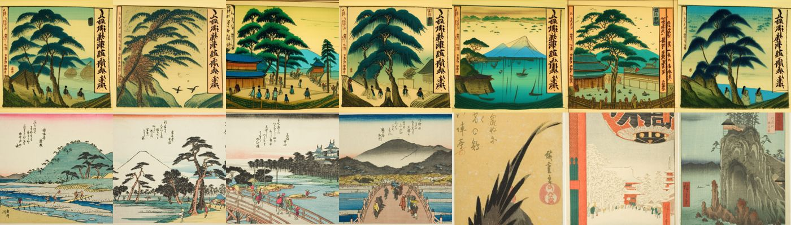
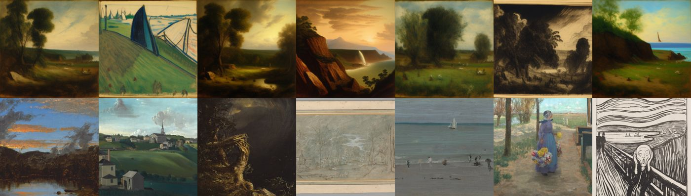
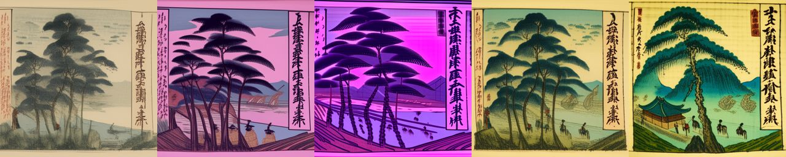
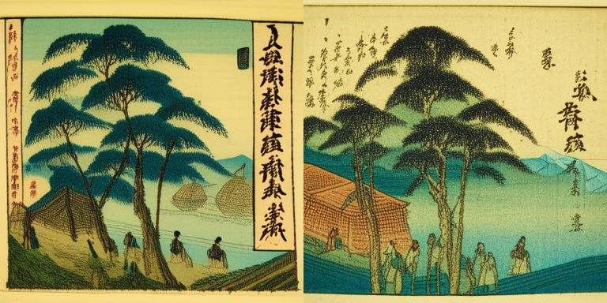

# The latent image of a collection: plan and sources

A Projects card for a student's thesis: train on the images a person keeps, make the collection's latent image from what the model learned, then measure a gallery against it. Written 2026-11-04; revised and built 2026-11-05, after Kevin allowed a larger model and some bending of the usual limits for this card. Licences were checked against the sources themselves.

**The latent image** of a collection is the picture the collection holds without any one image in it showing it. Kevin's words for it are the collection's "subconscious" or "pre-cognitive" picture. Here it is made statistically: it is the centre of what a model learned from all the images, made back into a picture.

**Card name:** *latent image*. On the card: **latent image · what a collection holds that no single image shows**.

This replaces the image-mood plan. That card, its commands and its result are on this branch in commit c58301a, not merged. Section 7 says what carries over.

**What changed on 2026-11-05.** The first version of this plan (commit 583660c) kept to an 8 GB Mac and recommended a 10 MB autoencoder (TAESD). Kevin then allowed a larger model. A fifth way, (5) below, was prototyped on this Mac and is far better: its latent image is a picture, not a blur. It is what the card is built on. It bends three of the usual limits, on purpose:

- **Download:** 9 GB (Kandinsky 2.2), against the usual ask-above-1-GB. On Kevin's machine it goes to KP 512 with the rest of his install.
- **Memory:** it needs a 16 GB Mac (it peaks at about 8 GB, 9 GB to train), not 8 GB. The helper refuses below 15 GB and says why.
- **Install:** torch and diffusers, about 1 GB in the python project's `latent` extra.

TAESD, (2) below, stays in this plan as the way to do it on an 8 GB Mac; it isn't built.

## 1. What the latent image is not

- It is not a memory or an unconscious in any literal sense. It is a mean and a few directions of spread, measured in a model's numbers. "Subconscious" and "pre-cognitive" are the thesis's frame, and the texts in section 4 give that frame its history. The card states this in its **what it can't do** line.
- It is not a portrait of the person. A collection of family photos gives a latent image with faces in it. Averaging faces is not reading what anyone feels, so the EU AI Act line from the mood plan doesn't apply. Galton made composites like this to argue for eugenics; the card's sources say so.

## 2. Images

The thesis's images are **the person's own**: a folder of phone photos or a body of work, brought in on the image segmentation tab (upload, or `look example`). Nothing is downloaded for them, and their licence is the person's.

To test without anyone's private photos, use a collection that is one person's work or one subject:

| Collection | Licence | Size | How |
|---|---|---|---|
| Art Institute of Chicago, public-domain works | CC0 (the API's own `license_text`; descriptions, not used, are CC BY) | 40–100 images by search, about 200 KB each at 843 px | `look museum "<artist or subject>" <set> --limit 100` (built in c58301a) |
| Cleveland Museum of Art open access | CC0 per record (`share_license_status`) | by search | `openaccess-api.clevelandart.org/api/artworks/?q=…&cc0=1&has_image=1` (not built) |
| The Met open access | CC0 (`isPublicDomain`) | by search | `collectionapi.metmuseum.org/public/collection/v1.1/search` (the v1 search was retired 2026-10-01); not built |

The test so far used 40 AIC landscapes (CC0) and, for contrast, 513 mixed OASIS photos. OASIS is research-only, so it is not for the final test; see the mood plan's notes.

## 3. Five ways to make it, from plain statistics to a large model

The first four were weighed for an 8 GB Mac; the first two were prototyped on this Mac (M1 Pro, 32 GB) on 2026-11-04. The fifth was prototyped and built on 2026-11-05. The picture below shows (1) and (2) for the 40 landscapes:

### (1) Pixel average: the baseline

- **How:** crop each image to a square, resize it, and average every pixel. This is Galton's composite, or Jason Salavon's averages.
- **Alignment:** with faces, Galton lined up the eyes. A general collection has nothing to line up, so the only alignment is the square crop.
- **What its latent image looks like:**
  - For the landscapes, a grey-green fog with a faint horizon.
  - For mixed OASIS photos, flat grey-brown.
- **What it means:** the collection's average light and colour, place by place in the frame. It knows nothing about what the images show.
- **Cost:** none. It is numpy, takes seconds and needs no download.

### (2) Average of a VAE's codes, decoded

A **VAE** (variational autoencoder) is a model that squeezes an image into a short code and back.

- **How:** encode each image, take the mean (or median) of the codes, and decode it. Also decode the main axes: the principal components of the codes, at the mean minus and plus two spreads.
- **Which VAE:**

  | VAE | Licence | Size |
  |---|---|---|
  | `stabilityai/sd-vae-ft-mse` | MIT | 335 MB |
  | `madebyollin/sdxl-vae-fp16-fix` | MIT | 335 MB |
  | `madebyollin/taesd` (Tiny AutoEncoder, same code space as Stable Diffusion's VAE) | MIT | **10 MB** |

  TAESD has two files of 4.9 MB each and is about 60 lines of MLX here. The prototype used it.
- **Measured:**
  - 513 pictures at 256 px encoded in 10 s; 1.0 GB peak.
  - 40 pictures in under a second.
  - The code is 32 × 32 × 4.
- **What its latent image looks like:**
  - For the landscapes: a warm, soft scene with light sky over dark ground.
  - For mixed OASIS photos: warm brown fog.
- **The axes** read as the collection's main tensions:
  - Landscapes, first axis: pale, open views against dark, heavy ones.
  - Landscapes, second axis: a framed dark mass against a luminous sky.
  - OASIS, first axis: light against dark. Second axis: orange warmth against blue sky.
  - The first axis holds 15–17% of the spread; the next ones 4–7% each.
- **What it means:** the centre of the collection in a space a model learned from millions of images. It is still an average, so it blurs. The more varied the collection, the more it blurs.
- **Cost:** 10 MB, seconds, any Mac.

### (3) Embedding statistics (SigLIP, Apache 2.0, already in the tool)

- **How:** take the mean and principal components of the collection's SigLIP embeddings. SigLIP's numbers are about what an image shows (a harbour, a portrait, snow), not where its light falls.
- **What its latent image looks like:** there is no picture. No small, permissively licensed generator turns a SigLIP embedding back into an image:
  - Kandinsky 2.2 (Apache 2.0) decodes image embeddings from a different, larger CLIP encoder (ViT-bigG/14). That is (5) below: it needs 9 GB of its files, not SigLIP's.
  - Stable unCLIP is under OpenRAIL-M, not a permissive licence.

  So this latent image can only be *shown* as the images nearest it, the most typical of the collection, and each axis as the images at its two ends.
- **What it means:** the collection's centre of subject matter. It is a useful second measure beside (2): an image can be near the latent image in look and far from it in subject.
- **Cost:** the 214 MB encoder already built; seconds.

### (4) A small model of your own, trained on the person's images

This is the "based on the training" version.

- **Small VAE on pixels**, in MLX:
  - Measured: 2.2M parameters, 17 ms a step of 32 images at 64 × 64, well under 1 GB.
  - 500 images for 300 passes is about 4,700 steps, about **80 seconds**; at 128 × 128, about 5 minutes.
  - Its latent image is its decoder's output at the centre of its code space: the origin, where its prior is densest.
  - With a few hundred images it is blurrier than (2), because it has learned from far fewer images than TAESD.
- **Small diffusion or flow model:**
  - Not measured; this estimate is from typical small models: a U-Net of about 30M parameters at 64 × 64 needs 50,000–200,000 steps, about 1.5–5 hours here.
  - It needs **thousands** of images. With a few hundred it memorises them and its "centre" is one of them.
  - Its latent image would be a sample drawn with the noise turned down, towards the most likely image.
  - Too slow and too data-hungry for a class session; possible for a thesis with time and a large archive.
- **Small VAE on the TAESD codes**, which combines (2) and (4):
  - The person's model learns their collection in TAESD's code space: 4,096 numbers an image instead of 196,608.
  - Its centre decodes through its own decoder, then TAESD's, at 256 px.
  - Training is as quick as the pixel VAE, and the picture is as sharp as (2).
  - It needs **50 images at the least, 200–1,000 to mean much**. Below that, the plain mean of the codes is as good.
  - A caution: if the model were linear, its centre would simply be the mean of the codes, which is (2). A small nonlinear model's centre differs from that mean, but that difference is not evidence of anything "deeper". The card compares the two and lets the student see.

### (5) A large encoder with a decoder: Kandinsky 2.2 (built)

Kandinsky 2.2 (Sber AI, **Apache 2.0**) is an encoder and a decoder that work in the same space of 1280 numbers:

- **The encoder** is CLIP ViT-bigG/14 (trained by LAION): it puts a picture into 1280 numbers, what it shows and how it looks.
- **The decoder** is a diffusion model of 1.2 billion weights with its own autoencoder (MoVQ): it draws a picture from any 1280 numbers.

So the centre of a collection, which no single picture has, can be drawn. That is what (3) lacked.

- **How:**
  - encode every picture;
  - fit the collection's statistics: the mean and the main axes (principal components) with their spreads;
  - decode the mean, scaled to a typical picture's length, since a mean is shorter than any one picture. That picture is the latent image.
  - Decode each of the first three axes at the mean minus and plus two spreads.
- **Decoding settings** (tested; see the picture below):
  - 30 denoising steps;
  - guidance 2.5, pushing away from the embedding of a plain grey picture.
  - Pushing away from all-zeros instead, as a quick first try did, cast every picture magenta.
- **Files:** `kandinsky-community/kandinsky-2-2-prior`, its image encoder only (3.7 GB); `kandinsky-community/kandinsky-2-2-decoder`, the U-Net (5.0 GB), MoVQ (0.27 GB) and configs. 9.0 GB in all. The prior's own diffusion model and text encoder (6.9 GB) aren't needed.
- **Measured on this Mac (M1 Pro, 32 GB, torch 2.15 on MPS):**
  - 99 pictures encode in 44 s; 513 in 188 s.
  - One 512 px picture decodes in about 16 s; the latent image and its axes, nine pictures, take about 3 minutes.
  - Peak memory is about 8 GB.
- **What its latent image looks like:**
  - **99 Hiroshige prints (CC0):** a whole Hiroshige-like scene: pines, a far mountain, travellers, a boat, a cartouche of text. The axes run from a bird study to a crowded street scene, and from Fuji over water to buildings and people.
  - **40 landscapes (CC0):** a 19th-century tonal landscape, trees against an evening sky.
  - **513 mixed OASIS photos:** a close view of earth and soil. That is the common ground of a camera roll of animals, food, weather and things; the pixel average of the same photos is brown fog. OASIS is research-only, so its picture isn't in this repository.

- **Training the decoder on the collection (the "based on the training" part):**
  - The statistics are fitted to the person's images. The decoder can also learn them: LoRA adds small weights (1.6M, rank 8, on the U-Net's attention) and trains only those, on the collection's own pictures.
  - Measured: 1.2 s a step of 2 pictures at 512 px in the prototype, 1.5 s through the helper (with the page open); 9 GB. 800 steps (16 passes over 100 pictures) took 16 and 20 minutes, plus about 5 minutes to draw the latent image and axes again with the trained decoder.
  - **What it changed, on Hiroshige:** the same centre drawn after training has the prints' scattered inscriptions instead of a boxed cartouche, and their paper tone and finer line. The subject stays; the look moves toward the collection.

- **What it means:** the centre of the collection in a space a very large model learned from hundreds of millions of pictures, drawn by a decoder that turns that space into pictures. It isn't a blur, because the decoder always draws a whole picture. That is also its limit: the decoder fills in what a centre doesn't say, in the manner of the pictures it was trained on. Training it on the collection moves that manner toward the person's own.
- **Cost:** 9 GB download, 16 GB Mac, about 3 minutes to make, about 25 to train and redraw.

### Recommendation (built)

**Main path: (5), Kandinsky 2.2, with its decoder trained on the collection as the second step.**

- It is the only way that gives a picture a reader recognises as the collection's, for a mixed collection as well as a coherent one.
- The statistics are fitted to the person's images, and the decoder then learns their look: that is "train on a person's images and make the latent image from what the model learned".
- **Beside it:** (1), the pixel average, as the baseline, on the same page.
- **(2), TAESD,** is the way to do it on an 8 GB Mac. It isn't built.
- **(4)** is not built: (5)'s training step does what it was for, better.

## 4. The texts

These texts are on the subconscious, memory and perception, and all are public domain in the US (Project Gutenberg). The table also notes their status outside the US.

| Text | Where | Notes |
|---|---|---|
| Freud, *The Interpretation of Dreams* (Brill translation, 1913) | Gutenberg **66048** | Freud died in 1939 and Brill in 1948, so it is also public domain where the term is life + 70. Freud compares dream "condensation" to **Galton's composite photographs**, three times. That is the thesis's own precedent. |
| Freud, *Psychopathology of Everyday Life* (Brill) | Gutenberg **67332** | as above |
| Freud, *Dream Psychology* (Eder translation) | Gutenberg **15489** | as above |
| Not these: Freud in the Strachey or Riviere translations, e.g. *Group Psychology* (Gutenberg **35877**) | | In copyright outside the US: Strachey died in 1967, so until 2038; Riviere died in 1962, so until 2033 |
| Galton, *Inquiries into Human Faculty* (1883) | Gutenberg **11562** | The source of the composite portrait, written for eugenics. Use it as history, not method. |
| Bergson, *Matter and Memory* (Paul & Palmer translation, 1911) | Not on Gutenberg; Internet Archive `mattermemory01berg` (1919 printing) | Public domain in the US (published before 1931); Bergson died in 1941 |
| Bergson, *Dreams* (Slosson, 1914) and *Creative Evolution* (Mitchell, 1911) | Gutenberg **20842**, **26163** | |
| William James, *The Principles of Psychology*, vol. 1 and 2 | Gutenberg **57628**, **57634** | The chapters on the stream of thought, memory and attention |
| William James, *Psychology: Briefer Course* | Gutenberg **55262** | |
| Goethe, *Theory of Colours* | Gutenberg **50572** | |
| Wikipedia: "Unconscious mind", "Preconscious", "Composite portrait", "Gestalt psychology" | `data raw wikipedia <title> <name>` (built) | CC BY-SA 4.0: credit the article, share alike |

**More texts, added 2026-11-09:** the critique of Freud, Jung and the critique of Jung (Dalal, Fanon), contemporary dream science (Domhoff, Hoel's overfitted brain), writing on images and memory (Benjamin, Warburg, Steyerl), and texts from Korea (*Kuunmong*, the *Samguk yusa*, taemong) and West Africa (Jedrej and Shaw, the Akan) are in [`latent-image-reading.md`](latent-image-reading.md). Each is marked public domain, open (with its licence) or library.

**How they enter: they don't change the model, and the card says so.** None of the five ways reads text: the encoder is given pictures only, and the trained decoder learns the person's images. So the texts stay as **framing**:

- a reading list on the card, with the Galton–Freud passage quoted;
- passages the student chooses, printed with the latent image on the gallery page, each with its source.

There is one place they could touch the numbers. A CLIP-like encoder can embed a sentence, so the sentences nearest each SigLIP axis could be listed as that axis's "name". In the mood test, SigLIP matched sentences about colour and light and missed abstract ones. James on memory, or Freud on condensation, would be matched almost at random. I'd leave that out rather than make the claim bigger than it is.

## 5. The gallery step

Point it at a folder: the collection itself, or another one ("how close are these museum pictures to my latent image?"). For each image it gives:

- **Distance from the latent image:** in the encoder's 1280 numbers, in units of the collection's own spread, so 1 is a typical picture of it. It also gives the cosine to the centre ("near in subject").
  - Measured: against the Hiroshige latent image, the 40 landscapes range from 0.88 to 2.15. The nearest is a Hiroshige print among them, then a Hokusai; the furthest is a Western *Annunciation*. The prints themselves range from 0.78 to 1.57.
- **The axes it pulls toward:** its position on the first five axes, with sign. Each axis is shown once at the top of the page as its two decoded ends, so "+2 on axis 1" can be seen, not just read.
- **What it brings:** the share of how the image differs from the centre that the first five axes don't explain. High means the image brings something the collection mostly lacks.
  - A heat map, as first planned, needs a model of pixels. This one measures the whole picture, so the map is replaced by a picture: for the images that bring most (4 by default), the latent image with that image's own unexplained part added, decoded. It shows what that image would bring to the centre.
  - Measured: for pictures far from the collection, the unexplained part is most of the picture, so "what it brings" is close to the picture itself in the collection's manner. Against the trained Hiroshige decoder, Munch's *The Scream* comes back as a woodblock-like print on Hiroshige's paper.

**Output:** `workspace/outputs/<set>-<model>/`:

- `gallery.html`, the contact sheet: the latent image (and the trained decoder's, if trained), the pixel average, the axes, and every image with its distance, axes (as bars) and what it brings, sorted from nearest to furthest. It is one file, sandboxed, as in c58301a.
- `latent.json`, with every number above.
- `latent.png`, `axis-<n>-<sign>.png` and `brings-<image>.png`.

## 6. The check

There is no right answer to score against, so the check is whether the statistics hold up. Each is the mean of 20 random splits.

- **The centre across halves:** split the collection in two at random and fit each half. The two centres' cosine should be 0.95 or more. A centre that changes with the half is noise, not the collection's.
- **Axis 1 across halves:** the two halves' first axes should point the same way: their cosine, ignoring sign, should be 0.7 or more. Below that the gallery page says to read the axes as a sketch.
- **Set-aside fit:** set 20% aside and fit the rest. The axes should explain about as much of how the set-aside images differ as of the training images: 0.75 or more of it.

**Measured:**

| Collection | Centre across halves | Axis 1 across halves | Set-aside fit |
|---|---|---|---|
| 100 Hiroshige prints (CC0), through the helper | **0.993**, stable | **0.72**, stable | 0.67 |
| 40 landscapes (CC0), prototype | 0.949, just under | 0.30, not stable | not measured |
| 513 mixed OASIS photos, prototype | 0.993, stable | 0.83, stable | not measured |

- **The centre holds** from about 40 pictures.
- **The axes need about 100.**
- **Set-aside fit is under 0.75 even at 100 prints:** five axes fitted to 80 pictures in 1280 numbers partly fit those 80 pictures themselves. The page reports it rather than hiding it. The axes are a description of this collection, not a law that new pictures will follow.

The 0.75 threshold was set before measuring; it may be too strict for so few pictures in so many numbers.

## 7. The build (done 2026-11-05)

| Step on the card | Tab | Command |
|---|---|---|
| get the picture encoder and decoder (Kandinsky 2.2, Apache 2.0, 9 GB) | Models | `model get kandinsky` |
| bring in the collection | Image segmentation | upload, or `look museum "Utagawa Hiroshige" hiroshige --limit 100` |
| bring in texts, as framing | Data | `data raw gutenberg 66048 freud-dreams`, `data raw gutenberg 65903 jung-unconscious`, `data raw gutenberg 59709 zhuangzi`, `data raw txt https://archive.org/download/cu31924023333077/cu31924023333077_djvu.txt kuunmong --license "public domain: Gale's translation, published 1922" --page https://archive.org/details/cu31924023333077`, `data raw wikipedia Composite_portrait composite-portrait` |
| make the latent image, its axes and the pixel average, and check it | Image segmentation | `latent make <name> images/<set>` |
| train the decoder on the collection (about 16 minutes) | Train | `latent train <name> [--steps 800]` |
| bring in a gallery | Image segmentation | `look museum landscape aic-landscapes --limit 40` |
| measure the gallery against it | Image segmentation | `latent gallery <name> images/<gallery> [--brings 4]` |

Not built: a package to run it outside Variable Machine. It would have to carry instructions for a 9 GB download, so the gallery page and `latent.json` are what leave the tool; `zip latents/<name>` shares the statistics, pictures and trained LoRA (a 16 MB zip for Hiroshige, 6.6 MB of it the LoRA).

**Carried over from c58301a:**

- `look museum`;
- `data raw wikipedia`;
- the sandboxed HTML gallery and its served type;
- the python extra pattern and the package's runs-without-Variable-Machine script;
- the Projects card format and step links.

**Still on the branch, below the new card:** the image-moods card, the `mood` commands, the OASIS import and SigLIP. They answer the old brief. Removing them is Kevin's call; they don't affect this card.

**New:**

- `model get kandinsky`: two repos into `workspace/tools/kandinsky/{prior,decoder}`, with a free-space check first;
- `python/variable_machine/latent.py` (torch, diffusers, peft): make, train, gallery;
- the `latent` extra in `python/pyproject.toml`;
- `helper/src/latent.ts`, with a memory check (16 GB);
- `workspace/latents/<name>/`, which `zip` and `trash` know;
- the card at the top of Projects (`ProjectsPanel.tsx`, `projects.md`);
- section 1 of `docs/projects-test-guide.md`.

**Tested** end to end through the helper on port 4841: 100 Hiroshige prints (made and trained), measured against the 40 landscapes and against themselves.
